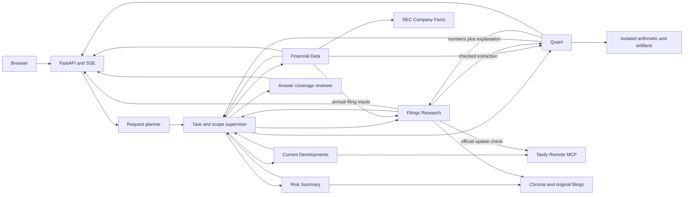

# Architecture

The application is a FastAPI browser chat backed by a LangGraph supervisor and five specialists: Filings Research, Financial Data, Financial Analysis / Quant, Risk Summary, and Current Developments. Each request has explicit company/year scope and an isolated evidence registry. [Project](project.md) defines coverage; [milestones](milestones/README.md) define status.

## Request and evidence

- Scope validates selected companies and fiscal years before generation. Explicit exclusions narrow company scope before worker selection; calendar timestamps do not become fiscal years. Historical year-end requests retain their intended scope. Unsupported companies/years return a coverage gap. Requests requiring unavailable prior-turn assumptions ask for clarification. The browser offers a clickable company correction that retains compatible years.
- `POST /api/chat` accepts optional `generation_profile=codex|api`. The browser Models control submits the selection; the server default applies only when omitted. A request-bound stream carries the selection through planner, workers and reviewer without mutating environment variables. Concurrent requests can select different profiles. The control is locked during a request. `GET /api/runtime` supplies profile availability and model identities without keys.
- A bounded semantic planner identifies each requested output before worker selection, including casual language, misspellings and outside-reaction requests. `request_plan` preserves output IDs/descriptions, per-output timeframe, reaction year and explicit dates independently of the worker plan. The supervisor enforces company scope, tool permissions and dependency order: Data → Quant for arithmetic, the annual filing-input handoff for supported components, Research for filing explanations, Risk Summary for complete-section comparisons, and Current Developments for outside research. A mixed request can invoke all five specialists; narrow requests avoid unrelated workers.
- Recognized capability questions use local role descriptions in `src/capabilities.py` without model or provider calls. Semantic planning also recognizes capability wording outside these shortcuts and answers from the same complete local description, including combined-answer support, without an external-research worker. Mixed casual clauses such as “and research” or “and look up” remain research outputs with normal scope checks. Capability claims do not require source citations.
- `TaskState` carries requested/complete outputs, required workers, ordered `Task` reasons/dependencies, worker outcomes, registered `EvidenceRef` records, missing inputs, counts and terminal status. Evidence preserves owner, exact value/unit/basis, currency, live URL/publisher/tier/publication date, observation time, fiscal dates, source/calculation IDs, lineage, provenance digest, inspection URL and bundle identity. Every handoff validates transactionally; conflicting IDs or changed figures are rejected. Worker copies prevent mutation of earlier evidence; echoed handoffs retain the authoritative full source rather than replacing it with a bounded narrative excerpt.
- Workers return to the supervisor after each task. Limits are seven steps, one supported evidence follow-up, 64 executed model tool calls, and a 210-second worker deadline. A later failure preserves earlier verified findings; unsupported inputs stay missing. SSE traces expose selection, handoff evidence, actual outcome, follow-up and termination. Requests remain self-contained with no cross-turn memory. [M9](milestones/supervisor/README.md) owns cooperation evidence and limits.
- `S` citations are registered passage IDs, `F` citations are financial observations, `C` citations are verified calculations, and `W` citations are live web sources. IDs and source hashes are checked. This proves provenance and arithmetic validity, not every narrative claim's semantic faithfulness.
- A separate bounded Answer Reviewer compares the original question, requested outputs, composed answer and cited source excerpts. Each cited source supplies up to 12,000 characters of its preferred text plus up to 24,000 characters of distinct immutable observations. Checked calculations include their registered financial-input lineage even when the answer cites only C results; intermediate inputs need not be printed unless requested. Typed models generate and validate the review schema. The reviewer checks clauses omitted by the plan and unsupported factual claims, while allowing clearly labeled interpretation grounded in cited facts. Unsupported sentences are removed at sentence boundaries, preserving supported neighboring sentences; one bounded second review checks the repaired answer. Further flagged sentences are removed and their gaps retained. Final remaining gaps determine status. Successful review can clear only worker-reported model uncertainty, preserving structural date/company/input gaps and failures. Outside research needs W evidence. A filing explanation cannot satisfy public reaction, and company statements cannot establish outside opinion. Missing or failed review prevents a complete result. `coverage_review` exposes addressed outputs and gaps independently of worker completion and citation registration.
- Completion states are completed, partial, needs clarification, coverage gap, unverified, and failed. Partial answers retain useful findings and identify unsupported requested outputs, without adding optional verification requirements. Ambiguous requests ask for clarification. `REQUEST_PLANNER=semantic` is the default; `rules` keeps deterministic routing for frozen regressions and omits model planning/review. Planner and reviewer calls have one structured tool slot and a 65-second deadline each.

## Sources and retrieval

- `data/source_inventory.json` selects 46 original company documents. The collector verifies identities, retrieval URLs, body/extraction hashes, and versions. AMD's amendment stays separate; quarterly risks retain annual context. Explicit refresh requires reingestion and application restart.
- The persistent Chroma index has 11,764 chunks, 220 WordPiece tokens with 40 overlap. CPU ONNX MiniLM generates normalized 384-dimensional embeddings; search uses cosine distance. The active manifest fingerprints settings and source metadata, so stale or corrupt indexes fail before retrieval. Chunks preserve exact prepared-text character offsets.
- Retrieval requires company/year filters; form, section, and version can narrow it. Search defaults to six passages, bounded to 1–12. Initial augmentation gets four passages per selected pair. Comparison search retrieves four per pair, single-pair search six, and reports empty pairs. Inspection returns exact text plus bounded context.
- Risk-change questions select Risk Summary, whose distinct tools inspect complete original sections, page subject alignment, and register added/removed/changed/relocated/unchanged wording. Both full inventories enter bounded context separately for each issuer; candidate similarity never establishes absence. Annual absence needs an exact complete original 10-K section; quarterly context uses the preceding annual. Mixed requests prepare both comparisons. A 200-second collection deadline retains completed issuers when later work fails. Amendment scope is inspected separately and cannot serve as annual absence evidence. Exact span citations recheck hashes through `/api/risks/{document_id}`. State carries `risk_sources`, `risk_changes`, and `risk_answer`. [M7](milestones/risk-summary/README.md) owns limits and classification rules.
- Current Developments owns external events and identifiable outside reactions through Tavily search and extraction. Each output selects its own research window. Ordinary recent questions use 90 days; stated months, seasons and relative calendar periods are normalized using today's date. Since-filing starts after each company's maximum inventory `source_date`. Historical reactions use three days before through 30 days after the earliest annual filing/release date for the output's year, defaulting to the latest selected fiscal year; release years must belong to selected corpus coverage. Calendar-year web intervals are independent of fiscal-year controls. Output dates take precedence; plan-wide dates apply only when the output inherits the same timeframe. Dates are validated and reversed intervals rejected. Filed explanations belong to Research, reported GAAP figures to Data with F citations, calculations to Quant with C citations, and filing risk comparisons to Risk Summary. External findings relate to handed-off facts without repeating the filing answer. State carries `current_answer`, `live_sources` and per-output research windows.
- Requested outputs determine live intent before execution. Official-update verification grants Research its shared search tool, including when the same request also needs Current Developments for events/reactions. Explicit no-web requests prohibit acquisition. Accounting terms and newest-collected-filing questions remain historical unless outside research is requested. Price requests retain supported clauses plus an explicit scope gap, with no worker when alone. Company/year coverage remains enforced. The trace includes request understanding, `live_intent`, selection reasons, handoffs and price gaps. The [17-row fixture](../tests/fixtures/live_routing.json) checks deterministic rules-mode routes; semantic planning and answer coverage have separate regression and application checks.
- Research generation uses the shared generation interface in the selected profile. Explicit amendment/MD&A questions add at most three targeted searches of two passages each, separating the explanatory note and original/amended MD&A. Clause-local routing keeps this task distinct from annual risk comparison. Research gets 180 seconds and `min(24, max(8, 3 × pairs))` tool calls. Worker budgets remain bounded by the supervisor, with the last slot reserved for completion. At most two denied calls allow correction before failure. Two turns can run per process. Local Codex CLI 0.162.1 uses configured default gpt-6.1-sol; login stays on the host and provider keys are removed from its subprocess environment.

## Generation routing

| Profile / role | Serving route | Dimension |
| --- | --- | --- |
| Codex, all generation | Local Codex app-server with a fresh thread | Explicit development selection |
| Hosted request planner | Nebius DeepSeek V4 Flash | Capability: planning errors cascade to every worker |
| Hosted narrow financial lookup and simple review | NVIDIA Super | Cost/capability: free grounded answers with citations |
| Hosted comparison, risk, filing explanation, Quant and outside synthesis | Nebius DeepSeek V4 Flash | Capability: reasoning over evidence-heavy synthesis and tool orchestration |
| Hosted complex review | Separate DeepSeek invocation | Original-request coverage with mixed evidence |

[M11](milestones/provider-routing/README.md#models-and-routing) owns exact model IDs, rule precedence, context/output caps and measured compatibility. Immutable routing context carries request/activity IDs, phase, assigned output, company/year counts, evidence kinds and source conflict. Each HTTP attempt emits provider, publisher, exact model, rule/reason and reserved limits; usage traces add latency, tokens and estimated cost. Codex emits the same model-route interface. Activity details retain each actual provider/model used, including a fallback, rather than replacing the display with a configured default.

The streaming adapter assembles tool fragments, validates JSON Schema, executes serially and preserves tool results across one bounded retry/fallback. Named structured tools retain Pydantic validation. A completion report follows a separate round reading tool results; final prose explicitly disables tools. Exact long text already supplied in the prompt is referenced instead of copied into later tool messages; full inspection evidence remains available. Workers receive their assigned output descriptions, while the original question stays available to review. The adapter emits answer text without reasoning or argument fragments. Cancellation closes HTTP and releases leases. Existing S/F/C/W and coverage checks remain authoritative. Review can clear worker-reported uncertainty while preserving structural gaps.

No code blocks provider spend. A per-host SQLite file paces NVIDIA's 40 requests per minute and records token-estimated usage; reaching the pace or any NVIDIA failure reroutes to DeepSeek. [Account limits](milestones/provider-routing/README.md#account-limits-and-usage) are instructions. The hosted profile runs on Cloud Run when keys are present. Credentials enter runtime only; fixed endpoints prevent arbitrary credential forwarding. API mode has no Codex fallback.

## Financial observations and analysis

- Four content-addressed SEC Company Facts snapshots yield consolidated original-accession GAAP USD observations. Selection checks accession, form, actual start/end interval, unit, company, and revision. Annual, quarter-only, and YTD observations are distinct. Later conflicting comparatives remain visible without replacing the original-report basis.
- The store has 378 slots: 346 available and 32 explicit gaps. It supports revenue, gross profit, operating income/loss, parent-attributable net income/loss, and operating cash flow. Qualcomm gross profit is revenue minus cost of revenue with both original inputs.
- Filing extraction supports Qualcomm FY2024/FY2025 annual automotive, handsets, IoT, and QCT revenue. It checks original table identity, USD millions, annual column, requested row, passage overlap, and hash. Shares use a denominator from the same filing and the selected consolidated or QCT basis.
- Quant executes assignment/arithmetic Python syntax in an isolated `-I -S -B` child with minimal environment, no imports/calls/loops/file/network access, a three-second wall limit, and Linux CPU/address-space/file-output caps. Windows has no OS memory cap. Decimal arithmetic and program/input limits are in [M6](milestones/quant/README.md).
- The independent validator recomputes values and executed lineage, checks company, unit, period, revision, denominator, and requested calculation coverage, then publishes hashed CSV/PNG/code/ledger bundles. Gross, operating and parent-attributable net margins use matching positive revenue denominators. Unresolved conflicting observations remain inspectable but cannot enter arithmetic. USD equality is exact; ratio/FX tolerance is 10^-8. Replay uses frozen inputs without generation.
- Growth needs a positive baseline; dollar change can include losses. Earnings rankings use parent-attributable GAAP net income and exclude nonpositive percentage bases. Cash conversion needs positive net income and matching intervals. Quarter-only differences use adjacent compatible cumulative intervals. User scenarios hold all other revenue unchanged; FX needs an explicit USD-per-EUR rate. Missing, revised, or incompatible inputs yield partial results.

## HTTP, browser, and local container

| Route | Purpose |
| --- | --- |
| `GET /`, `GET /api/coverage` | Chat page and supported scope |
| `GET /api/runtime` | Default/available generation profiles and configured model identities |
| `GET /api/live/{snapshot_id}` | Scrubbed, checksum-verified live MCP snapshot |
| `POST /api/chat` | Self-contained request; SSE answer and trace |
| `GET /api/sources/{chunk_id}`, `GET /api/originals/{document_id}` | Passage inspection and original download |
| `GET /api/financial/observations/{id}`, `GET /api/financial/snapshots/{sha}` | Exact value and source snapshot |
| `GET /api/analysis/{bundle}/calculations/{C}`, `/observations/{F}`, `/snapshots/{sha}`, `/files/{name}` | Frozen analysis inspection and downloads |

SSE emits activity, trace, tool, evidence, token, answer replacement, sources, artifacts, scope, error, and terminal complete events. Answer Markdown uses locally vendored Marked and DOMPurify with raw HTML and remote images disabled; source inspections remain text nodes. Headings, emphasis, lists, tables, quotes, code and safe links render during streaming. Registered citations retain trusted inspection targets, including after replacement answers or repeated source events; code examples remain literal. Original HTML downloads as an attachment. A bounded event queue and keep-alives support streaming. Disconnect cancels the owned generation process.

Activity events identify each executed invocation with `id`, `agent`, and `status`: running, then its actual outcome. Starts include the task; worker endings include newly registered sources. The HTTP stream adds monotonic `elapsed_ms` from graph admission, excluding queue wait. Supervisor planning and answer review have their own intervals; repeated worker calls retain separate IDs. These events observe existing execution without additional model or web calls.

[`web/agent-activity.js`](../web/agent-activity.js) renders a stack and expandable elapsed-time timeline. Financial Data is blue, Quant purple, Filings Research teal, Risk Summary amber, and Current Developments rose; orchestration is gray. Every call has a name, status, and duration. Both views select the same task/model/tool/source details and use the existing source inspector. Running clocks interpolate between server timestamps; completed intervals retain server durations. Stop, errors, and an unterminated stream freeze unfinished calls as stopped, failed, or unverified. Each request clears prior activity. The stack appears beside the answer on desktop and above it on phones. Keyboard controls, visible focus, text status announcements, and labels accompany color. The full routing/tool trace remains available.

Current-development and official-update examples preserve the company controls. A requested-output checklist shows what is being researched and what the reviewer finds addressed or still needed. Complete status distinguishes reviewed request coverage from citation registration alone. Live source inspection labels publisher, publication date or date unavailable, primary source or independent reporting, retrieval time and date provenance. It renders excerpts as text nodes and opens HTTP(S) source URLs with `noopener noreferrer`. The [vendor record](../web/vendor/README.md) pins browser-library versions, source archives and licenses; FastAPI serves them at `/static/vendor/`, and Docker includes them without a frontend build step.

## MCP tool sharing

Current Developments and Filings Research invoke the same `tavily_search` tool on Tavily Remote MCP over Streamable HTTP. Current Developments researches the requested external events/reactions; Research checks whether an official source updates one specific filed statement, preserving the filed S citation before a separate W update. Only an official-tier source establishes an official update. General developments permit supported attributed reporting without adding an official-confirmation requirement.

One credential, ledger, scrubber and live-search integration serve both agents. Research has narrow verification access; Current Developments also has `tavily_extract` and local source inspection. Each gateway call emits `node=live_mcp`, agent, discovered server name, tool, scrubbed arguments, result count, snapshot identity, cache flag and outcome. [M10 evidence](milestones/current-developments/README.md) contains real calls from both agents to `server=tavily-mcp`, `tool=tavily_search`.

Current Developments has eight model tool calls including its completion report, with at most three searches and three single-URL extracts across all selected companies in a semantically planned request. Research verification has one search with `topic=general`. Semantic searches use advanced depth, five results, explicit start/end dates and no raw content; domain restrictions use `include_domains`. Extraction accepts a focused query, text format and basic/advanced depth for a URL returned by the request. Optional parameters are sent only when the discovered schema supports them; the verified Remote MCP schema has no `chunks_per_source`. Rules-only/direct requests retain the two-search/two-extract basic profile. Searches cache for six hours and extracts for 24; explicit refresh bypasses caching within the same budgets.

Every uncached call initializes/discovers tools and is recorded at an estimated two credits before execution, including failures. No code limits monthly Tavily use; the project allowance is an instruction in [AGENTS.md](../AGENTS.md).

`LIVE_MODE` supports live, frozen replay and off; a key enables live by default. `LIVE_CACHE` and `LIVE_LEDGER` select the content-addressed snapshots and per-host usage record. Missing credentials, disabled acquisition, provider errors, timeout, empty results and per-request search limits expose partial outcomes while retaining earlier evidence.

Live records preserve URL, registrable-domain publisher, title, company, publication/retrieval dates, tier, freshness, bounded text/hash, snapshot/tool/agent and `/api/live/{snapshot_id}`. Official hosts include the selected issuer domains, sec.gov and .gov hosts. PR Newswire and Business Wire pages qualify only with explicit attribution to the selected issuer. Publication dates come from Tavily metadata, page publication metadata, explicit labels or release datelines, including issuer city/date datelines after header teasers. `date_source`, `date_excerpt` and `date_snapshot_id` preserve their basis. URL dates, retrieval times and incidental event dates do not establish publication. Canonical URL identity removes tracking parameters/fragments and deduplicates search/extraction citations. Immutable observations retain each snapshot's text/hash/date independently. The canonical W record prefers the extracted body over shorter search text and preserves a known date when extraction omits it.

Publication within 90 days is fresh; older evidence is dated; unsupported dates remain undated. A current-status sentence supported only by non-fresh W sources forces partial output. Navigation and embedded image data are removed before text limits: search stores up to 1,800 characters and supplies 1,000; extraction stores up to 20,000 and supplies 6,000 inside untrusted-content blocks. Historical reaction evidence can establish relevance through an explicit event/date in its text despite missing publication metadata; an explicit publication interval still needs a supported publication date. Unknown or malformed W references become unverified-source markers. Source labels and hashes prove provenance, not semantic truth. Quant valuation is unsupported.

The local Docker image is digest-pinned Python 3.13, runs as UID 10001, honors `PORT`, and mounts corpus/models read-only with an isolated writable index. The Codex container profile uses an authenticated host bridge; the API profile uses runtime-injected provider keys and the mounted ledger without a bridge. The image contains no CLI login or credentials. Local acceptance is in [M4](milestones/local-container/README.md) and [M11](milestones/provider-routing/README.md). Cloud behavior remains unmeasured.
