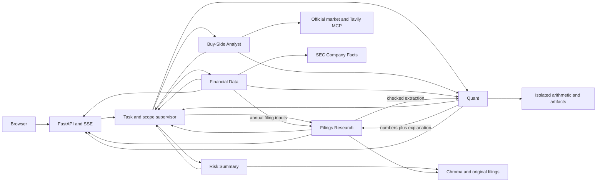

# Architecture

The application is a FastAPI browser chat backed by a LangGraph supervisor and five specialists: Filings Research, Financial Data, Financial Analysis / Quant, Risk Summary, and Buy-Side Analyst. Each request has explicit company/year scope and an isolated evidence registry. [Project](project.md) defines coverage; [milestones](milestones/README.md) define status.

## Request and evidence

- Scope validates selected companies and fiscal years before generation. Explicit exclusions and historical year-end demand keep their intended scope. Unsupported companies/years or genuinely live requests return a coverage gap. The browser offers a clickable company correction that retains compatible years.
- The supervisor derives requested outputs and a dependency plan: Research for filing explanations, Data for source figures, Data → Quant for arithmetic, a supported annual filing-input handoff for components, Risk Summary for complete-section comparisons, and Buy-Side for dated market output. A mixed request can invoke all five specialists; quote and risk-only requests avoid unrelated workers.
- `TaskState` carries requested/complete outputs, required workers, ordered `Task` reasons/dependencies, worker outcomes, registered `EvidenceRef` records, missing inputs, counts and terminal status. Evidence preserves owner, exact value/unit/basis, currency, dilution, splits, horizon, observation time, fiscal dates, source/calculation IDs, lineage, provenance digest, inspection URL and bundle identity. Every handoff validates transactionally; conflicting IDs or changed figures are rejected. Worker copies prevent mutation of earlier evidence; echoed handoffs retain the authoritative full source rather than replacing it with a bounded narrative excerpt.
- Workers return to the supervisor after each task. Limits are seven steps, one supported evidence follow-up, 64 executed model tool calls, and a 210-second worker deadline. A later failure preserves earlier verified findings; unsupported inputs stay missing. SSE traces expose selection, handoff evidence, actual outcome, follow-up and termination. Requests remain self-contained with no cross-turn memory. [M9](milestones/supervisor/README.md) owns cooperation evidence and limits.
- `S` citations are registered passage IDs, `F` citations are financial observations, and `C` citations are verified calculations. IDs and source hashes are checked. This proves provenance and arithmetic validity, not every narrative claim's semantic faithfulness.
- Completion states are completed, partial, needs clarification, coverage gap, unverified, and failed. Partial answers retain available evidence and list missing outputs; ambiguous requests ask for clarification.

## Sources and retrieval

- `data/source_inventory.json` selects 46 original company documents. The collector verifies identities, retrieval URLs, body/extraction hashes, and versions. AMD's amendment stays separate; quarterly risks retain annual context. Explicit refresh requires reingestion and application restart.
- The persistent Chroma index has 11,764 chunks, 220 WordPiece tokens with 40 overlap. CPU ONNX MiniLM generates normalized 384-dimensional embeddings; search uses cosine distance. The active manifest fingerprints settings and source metadata, so stale or corrupt indexes fail before retrieval. Chunks preserve exact prepared-text character offsets.
- Retrieval requires company/year filters; form, section, and version can narrow it. Search defaults to six passages, bounded to 1–12. Initial augmentation gets four passages per selected pair. Comparison search retrieves four per pair, single-pair search six, and reports empty pairs. Inspection returns exact text plus bounded context.
- Risk-change questions select Risk Summary, whose distinct tools inspect complete original sections, page subject alignment, and register added/removed/changed/relocated/unchanged wording. Both full inventories enter bounded context separately for each issuer; candidate similarity never establishes absence. Annual absence needs an exact complete original 10-K section; quarterly context uses the preceding annual. Amendment scope is inspected separately and cannot serve as annual absence evidence. Exact span citations recheck hashes through `/api/risks/{document_id}`. State carries `risk_sources`, `risk_changes`, and `risk_answer`. [M7](milestones/risk-summary/README.md) owns limits and classification rules.
- Buy-Side Analyst owns dated market and consensus inspection, conditional scenarios, and missing-input explanations. A fixed acquisition plan uses official Twelve Data stdio MCP, Alpha Vantage Remote MCP, and Tavily Remote MCP. Quant owns independent valuation arithmetic and replayable artifacts. State carries `buy_sources`, `buy_answer`, and `valuation_bundles`; `/api/market/{identity}` opens scrubbed snapshots. [M8](milestones/buy-side-analyst/README.md) owns eligibility, freshness, budgets, account evidence, and display limits.
- Research generation runs through local Codex app-server with a fresh request thread. Verified local CLI: 0.162.1; configured default model: gpt-6.1-sol. It gets 180 seconds and `min(24, max(8, 3 × pairs))` tool calls; other phases get eight. The last available slot is reserved for an explicit completion report. At most two denied calls allow final synthesis before hard failure. Two turns can run per process. CLI authentication stays on the host; provider keys are removed from the generation subprocess environment.

## Financial observations and analysis

- Four content-addressed SEC Company Facts snapshots yield consolidated original-accession GAAP USD observations. Selection checks accession, form, actual start/end interval, unit, company, and revision. Annual, quarter-only, and YTD observations are distinct. Later conflicting comparatives remain visible without replacing the original-report basis.
- The store has 378 slots: 346 available and 32 explicit gaps. It supports revenue, gross profit, operating income/loss, parent-attributable net income/loss, and operating cash flow. Qualcomm gross profit is revenue minus cost of revenue with both original inputs.
- Filing extraction supports Qualcomm FY2024/FY2025 annual automotive, handsets, IoT, and QCT revenue. It checks original table identity, USD millions, annual column, requested row, passage overlap, and hash. Shares use a denominator from the same filing and the selected consolidated or QCT basis.
- Quant executes assignment/arithmetic Python syntax in an isolated `-I -S -B` child with minimal environment, no imports/calls/loops/file/network access, a three-second wall limit, and Linux CPU/address-space/file-output caps. Windows has no OS memory cap. Decimal arithmetic and program/input limits are in [M6](milestones/quant/README.md).
- The independent validator recomputes values and executed lineage, checks company, unit, period, revision, denominator, and requested calculation coverage, then publishes hashed CSV/PNG/code/ledger bundles. Gross, operating and parent-attributable net margins use matching positive revenue denominators. Unresolved conflicting observations remain inspectable but cannot enter arithmetic. USD equality is exact; ratio/FX tolerance is 10^-8. Replay uses frozen inputs without generation.
- Growth needs a positive baseline; dollar change can include losses. Earnings rankings use parent-attributable GAAP net income and exclude nonpositive percentage bases. Cash conversion needs positive net income and matching intervals. Quarter-only differences use adjacent compatible cumulative intervals. User scenarios hold all other revenue unchanged; FX needs an explicit USD-per-EUR rate. Missing, revised, or incompatible inputs yield partial results.

## HTTP, browser, and local container

| Route | Purpose |
| --- | --- |
| `GET /`, `GET /api/coverage` | Chat page and supported scope |
| `POST /api/chat` | Self-contained request; SSE answer and trace |
| `GET /api/sources/{chunk_id}`, `GET /api/originals/{document_id}` | Passage inspection and original download |
| `GET /api/financial/observations/{id}`, `GET /api/financial/snapshots/{sha}` | Exact value and source snapshot |
| `GET /api/analysis/{bundle}/calculations/{C}`, `/observations/{F}`, `/snapshots/{sha}`, `/files/{name}` | Frozen analysis inspection and downloads |

SSE emits trace, tool, evidence, token, answer replacement, sources, artifacts, scope, error, and terminal complete events. The browser shows routing and source panels; it renders model/source text as text nodes. Original HTML downloads as an attachment. A bounded event queue and keep-alives support streaming. Disconnect cancels the owned generation process.

The local Docker image is digest-pinned Python 3.13, runs as UID 10001, honors `PORT`, and mounts corpus/models read-only with an isolated writable index. An authenticated host bridge starts one local Codex child per connection; the image contains no CLI login. Local acceptance is in [M4](milestones/local-container/README.md). Cloud behavior and deployed provider routing are unmeasured.
