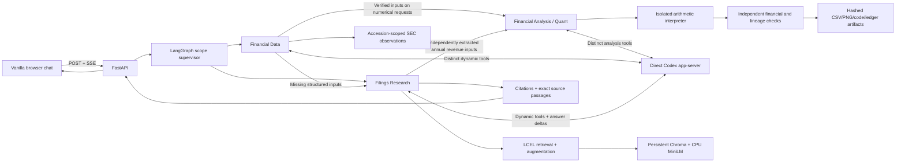

# Architecture

- Owner: Rylan Wade.
- Status: M3 local filings research is implemented and verified; accepted. M1/M2 are verified and M2 is accepted. Local Docker, Financial Data, and Quant pass. Risk Summary, full cooperation, formal evaluations, and deployment are unimplemented.
- Contract: [assignment](assignment/Assignment_2_Description.md), [project scope](planning/PROJECT_SPEC.md), and [M3 demonstration](planning/M3_FIRST_RAG_RESEARCH_DEMO.md).

## Local request path

- `main.py` serves the vanilla HTML/JS document and SSE. `src/research_workflow.py` owns the graph, worker, scope validation, LCEL pipeline, and request-local evidence registry.
- Graph paths after `supervisor`: `research → finish`, `data → finish`, `analysis_data → quant → finish`, or `data → revenue_inputs → quant → finish`. Missing structured inputs can make one bounded Research follow-up; unverified revenue inputs fall back to a partial Research answer. `START` enters the supervisor; `finish` reaches `END`. Unsupported scope routes directly to finish. Explicit capability rules select supported structured metrics or filing research. Full task-driven cooperation and provider routing are unimplemented.
- State contains question, companies, fiscal years, selected worker, answer, error, and registered financial sources, calculation rows, and artifact identity. Each request owns a separate evidence registry and ephemeral Codex thread. No cross-turn memory or durable conversation state exists.
- Request state also carries an optional revenue component/share requirement, earnings-ranking flag, structured `needs_evidence`, and partial-result status. `src/filing_financials.py` establishes supported annual revenue inputs from immutable original table evidence; `src/quant_workflow.py` checks requested calculation coverage and records a verified earnings assessment in the content-addressed bundle. [Capability contracts](planning/CAPABILITY_ROUTING_AND_REVENUE_SHARES.md) define limits and reproduction.
- Filings Research uses its own [role prompt](../prompts/filings_research.md) and two actual tools: `search_sources` and `inspect_source`. The same worker runs independently through `scripts/research.py agent`.
- Risk Summary, full cooperation, Tavily live retrieval, shared source MCP, and two-provider routing remain unimplemented. Financial Data uses distinct structured-query/observation-inspection tools.

## Corpus and ingestion

- All 46 selected originals/extractions are verified: 36 original filings, nine full-year/Q4 earnings releases, and AMD's FY2025 amendment. All four companies cover FY2024–FY2025; NVIDIA retains FY2026. [Aligned coverage](planning/ALIGNED_FISCAL_COVERAGE.md) records source checks and actual fiscal dates.
- `src/research_index.py` loads the verified M2 manifest and checks prepared UTF-8 text hashes before ingestion. It preserves SEC filing identity, separate amendments, and original source bytes.
- Persistent Chroma stores **11,764 scoped chunks** in ignored `chroma_index/`; the published `active.json` records the verified count and fingerprint. A fingerprint covers embedding/chunk settings and source/provenance/extraction metadata. Complete ingestion publishes `active.json`; queries reject a fingerprint mismatch. Ingestion resumes existing chunk IDs and verifies the final count before publication.
- MiniLM `all-MiniLM-L6-v2` generates normalized 384-dimensional embeddings through CPU ONNX inference. Chroma 1.5.9 pins the implementation; the 79.3 MiB archive has SHA-256 `913d7300ceae3b2dbc2c50d1de4baacab4be7b9380491c27fab7418616a16ec3`. First ingestion downloads it to the Chroma user cache. CPU sessions use four intra-op threads and one inter-op thread.
- Chunking uses the model WordPiece tokenizer with **220 tokens and 40-token overlap**. Chunking disables tokenizer truncation/padding; embedding retains its 256-token limit. Chunks never cross a prepared PDF page or selected risk/MD&A section boundary. Offsets refer to original prepared text, including Unicode and PDF layout spacing.
- Chunks retain document ID, company, fiscal year, source kind/form, period end, version, canonical URL, section, page, character range, and text hash. IDs derive from document identity, text hash, and offsets.
- AMD's amendment has corrected MD&A and no replacement risks. Quarterly risks remain updates; inspection retains their annual/context note.

## Retrieval, augmentation, and grounding

- Cosine Chroma search requires company/fiscal-year filters, with optional form, section, and original/amendment filters. Default top-k is six, bounded to 1–12.
- Initial augmentation retrieves four passages per selected company/year so one company cannot monopolize a comparison. The HTTP request permits four companies and two fiscal-year labels; every selected pair must have coverage.
- LCEL composes `RunnableLambda(retrieve) | RunnableLambda(augment)`. Augmentation contains the actual worker prompt, question, explicit scope, and source passages assigned request-local `[S1]` identifiers. Source quotations are marked untrusted evidence.
- `search_sources(query, company?, year?, form?, section?, version?)` cannot broaden the selected company/year scope. `inspect_source(source_id)` accepts an already registered passage and returns exact text plus up to 500 surrounding characters on each side.
- Complete answers require registered citation IDs and hash-checked exact source text for cited passages. Unknown IDs, absent citations, or empty answers produce an unverified result. Identifier/provenance checks do not establish claim-level faithfulness; formal evaluation and claim review remain pending.
- Unsupported company/year selections, question/selection mismatches, and explicit current/live requests produce coverage explanations before generation. Missing retrieval, corrupt text, stale index, unavailable models, and timeouts produce explicit failure events.
- Scope parsing is conservative. Fiscal labels and calendar dates can require clarification; unrecognized company names rely on worker abstention and remain a limitation.

## Direct Codex generation

- `src/codex_model.py` uses the installed CLI's JSON-RPC app-server protocol. Verified CLI: **0.162.1**; default model: **gpt-6.1-sol**. `RESEARCH_MODEL` selects another accessible model. [Official protocol](https://learn.chatgpt.com/docs/app-server).
- The adapter initializes experimental dynamic tools, starts a fresh ephemeral read-only thread, submits augmented evidence, executes application-owned tool calls, and yields final-answer text deltas. Commentary is excluded from answer tokens.
- Local generation uses `codex login`; HW2 does not read/copy credential stores or require an application generation API key. The adapter requests disabled shell/browser/application tools and supplies explicit research instructions. It is a local research workflow, not a code-execution sandbox for untrusted users.
- Model work is bounded to 180 seconds/eight dynamic tool calls. Unexpected server requests are rejected. Cancellation/timeout closes the owned process. FastAPI permits two concurrent turns per process; distributed scheduling and production concurrency acceptance are pending.
- Traces identify the actual Codex subscription provider/model/reason. Nebius Token Factory and the tentative NVIDIA-hosted provider remain unverified. Subscription observations do not establish their price, quality, or latency.

## HTTP and browser contracts

| Route | Behavior |
| --- | --- |
| `GET /` | Single vanilla HTML/CSS/JS page; no frontend build. |
| `GET /api/coverage` | Verified companies and fiscal-year labels. |
| `POST /api/chat` | Validated self-contained question/companies/years; SSE. |
| `GET /api/sources/{chunk_id}` | Hash-checked exact passage/context, fiscal dates, version, source links. |
| `GET /api/originals/{document_id}` | Hash-checked collected original as an attachment. |

- SSE types: `trace`, `tool`, `evidence`, `token`, `sources`, `artifacts`, `scope`, `error`, terminal `complete`. Status distinguishes completed, partial, coverage gap, unverified, and failed. `scope` carries an explicit suggested company selection; the browser changes selection only when the user clicks its correction button and retains compatible selected years.
- The fetch-based consumer decodes fragmented UTF-8/SSE frames, displays live answer tokens, links citations to highlighted exact passages, exposes routing/tools, and supports Stop through cancellation. A bounded 128-event queue and 0.5-second keep-alive frames keep delivery responsive during model waits. Cleanup shields graph-task cancellation from repeated ASGI cancellation; a real disconnect check leaves zero owned Codex children after two seconds.
- Model/source text uses DOM text nodes. Prepared HTML originals download as attachments. Links provide SEC, official retrieval source, and collected original; SEC access can return 403.
- Sources/index are ignored reproducible data. Source refresh requires explicit ingestion and an application restart; no automatic freshness service exists.

## Verification and remaining work

- Focused tests cover scope isolation, Unicode offsets/boundaries, corrupt/stale sources, unsupported coverage, citation identifiers, and terminal failures. M2 tests remain applicable.
- Actual results: 19 tests pass; four company retrieval/application questions pass; three unsupported/current requests return coverage gaps; one separate direct AMD worker run and one Chromium citation/trace demonstration pass. The HTTP checks verify an original-file hash, missing-source 404, and invalid-request 422. An unavailable Codex model fails explicitly; live request cancellation closes the owned process.
- [Demonstration evidence](research/M3_DEMONSTRATION_RESULTS.json) records actual retrieval, application turns, tools, cited passages, and local timing. [Browser evidence](research/M3_BROWSER_RESULTS.json) records Chromium chat/source interaction.
- Formal RAGAS/AgentEvals, risk alignment, shared/live MCP, additional generation providers, Cloud Run, and deployment measurements remain pending. Financial calculations and source-linked artifacts are verified in M6. Local Docker acceptance is verified in [M4](planning/M4_LOCAL_CONTAINER_ACCEPTANCE.md).

## Local container runtime

- Digest-pinned Python 3.13-slim multi-stage image, exact requirements, UID 10001, and injected `PORT`. The allowlisted build context excludes credentials, generated data, and development artifacts.
- Read-only corpus/model mounts and an isolated writable Chroma copy preserve native index independence.
- `CODEX_BRIDGE_URL` and `CODEX_BRIDGE_TOKEN_FILE` select an authenticated local bridge. The host retains CLI credentials and owns/kills a separate app-server process per connection. Native runs use the same transport interface with a local child.
- [M4 acceptance](planning/M4_LOCAL_CONTAINER_ACCEPTANCE.md) records runnable commands, browser/model evidence, cancellation, measured resources, and development-only boundaries.

## Structured financial evidence

- Financial Data has its own prompt, `query_financials` and `inspect_observation`, graph node, and direct CLI. Company/year filters are request scoped. Registered F citations use observation IDs, independently of semantic RAG S citations.
- Four content-addressed Company Facts snapshots supply exact original-accession GAAP USD observations, with explicit annual/quarter/YTD intervals, amendment separation, conflict/missing statuses, and retained later comparative revisions. Qualcomm gross profit retains both inputs and its formula; 53-week context remains visible.
- `FinancialStore` verifies inventory/snapshot identity and reconstructs prepared observations before serving them. No chat-time financial download or automatic refresh occurs.
- Source inspection routes expose observation metadata and hash-checked snapshots. Browser text-node rendering preserves safe display. [M5](planning/M5_FINANCIAL_DATA_AGENT.md) describes schemas, selection policy, CLI, API, and evidence.

## Bounded Quant and immutable analysis artifacts

- Quant has a distinct prompt and `run_analysis`/`inspect_calculation`. Data establishes scoped observations; the graph passes them to Quant and keeps the Data answer out of final tokens. Direct Quant runs bypass Data-model/supervisor/browser generation.
- `quant_runner.py` interprets an assignment/arithmetic subset without eval/exec in an isolated, credential-free child. Size, AST, operation, depth, numeric, output, and three-second bounds apply; Linux also caps CPU/address-space/file output. Windows does not claim an OS memory sandbox. Active execution children participate in HTTP request cleanup.
- `quant_analysis.py` independently recomputes results and checks executed versus declared lineage, company/units/accounting/revision basis, intervals, denominators, quarterly adjacency, and 53-week qualifications. Percent/point tolerance is 10^-8; USD arithmetic is exact.
- Only verified calculations publish through `analysis_artifacts.py`: a hashed ledger, source observations, chart-series metadata, CSV, Matplotlib PNG, and generated code. Sources remain frozen per bundle; snapshot downloads verify hashes. These local files do not promise durable Cloud Run state.
- HTTP inspection: `/api/analysis/{id}/calculations/{C}`, `/observations/{F}`, `/snapshots/{sha}`, and `/files/{name}` beneath the same bundle path. Only known bundle/file/source identities are served.
- Browser SSE `artifacts` events render canonical result labels, values/units/dates, chart, and downloads. [M6](planning/M6_FINANCIAL_ANALYSIS_QUANT_AGENT.md) records exact limits, policies, schema, commands, and actual native/Docker evidence.
