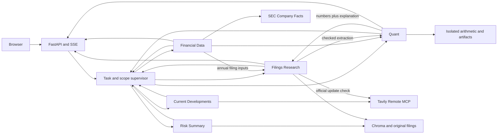

# Architecture

The application is a FastAPI browser chat backed by a LangGraph supervisor and five specialists: Filings Research, Financial Data, Financial Analysis / Quant, Risk Summary, and Current Developments. Each request has explicit company/year scope and an isolated evidence registry. [Project](project.md) defines coverage; [milestones](milestones/README.md) define status.

## Request and evidence

- Scope validates selected companies and fiscal years before generation. Explicit exclusions narrow company scope before worker selection; calendar timestamps do not become fiscal years. Historical year-end requests retain their intended scope. Unsupported companies/years return a coverage gap. Requests requiring unavailable prior-turn assumptions ask for clarification. The browser offers a clickable company correction that retains compatible years.
- The supervisor derives requested outputs and a dependency plan: Research for filing explanations, Data for source figures, Data → Quant for arithmetic, a supported annual filing-input handoff for components, Risk Summary for complete-section comparisons, and Current Developments for post-anchor live events. A mixed request can invoke all five specialists; live-only and risk-only requests avoid unrelated workers.
- Capability questions use the local role descriptions in `src/capabilities.py` without model or provider calls. They describe implemented behavior and limits; mixed capability/research questions retain the research clause and its normal scope checks. A capability-only response completes without claiming source citations were checked.
- `TaskState` carries requested/complete outputs, required workers, ordered `Task` reasons/dependencies, worker outcomes, registered `EvidenceRef` records, missing inputs, counts and terminal status. Evidence preserves owner, exact value/unit/basis, currency, live URL/publisher/tier/publication date, observation time, fiscal dates, source/calculation IDs, lineage, provenance digest, inspection URL and bundle identity. Every handoff validates transactionally; conflicting IDs or changed figures are rejected. Worker copies prevent mutation of earlier evidence; echoed handoffs retain the authoritative full source rather than replacing it with a bounded narrative excerpt.
- Workers return to the supervisor after each task. Limits are seven steps, one supported evidence follow-up, 64 executed model tool calls, and a 210-second worker deadline. A later failure preserves earlier verified findings; unsupported inputs stay missing. SSE traces expose selection, handoff evidence, actual outcome, follow-up and termination. Requests remain self-contained with no cross-turn memory. [M9](milestones/supervisor/README.md) owns cooperation evidence and limits.
- `S` citations are registered passage IDs, `F` citations are financial observations, `C` citations are verified calculations, and `W` citations are live web sources. IDs and source hashes are checked. This proves provenance and arithmetic validity, not every narrative claim's semantic faithfulness.
- Completion states are completed, partial, needs clarification, coverage gap, unverified, and failed. Partial answers retain available evidence and list missing outputs; ambiguous requests ask for clarification.

## Sources and retrieval

- `data/source_inventory.json` selects 46 original company documents. The collector verifies identities, retrieval URLs, body/extraction hashes, and versions. AMD's amendment stays separate; quarterly risks retain annual context. Explicit refresh requires reingestion and application restart.
- The persistent Chroma index has 11,764 chunks, 220 WordPiece tokens with 40 overlap. CPU ONNX MiniLM generates normalized 384-dimensional embeddings; search uses cosine distance. The active manifest fingerprints settings and source metadata, so stale or corrupt indexes fail before retrieval. Chunks preserve exact prepared-text character offsets.
- Retrieval requires company/year filters; form, section, and version can narrow it. Search defaults to six passages, bounded to 1–12. Initial augmentation gets four passages per selected pair. Comparison search retrieves four per pair, single-pair search six, and reports empty pairs. Inspection returns exact text plus bounded context.
- Risk-change questions select Risk Summary, whose distinct tools inspect complete original sections, page subject alignment, and register added/removed/changed/relocated/unchanged wording. Both full inventories enter bounded context separately for each issuer; candidate similarity never establishes absence. Annual absence needs an exact complete original 10-K section; quarterly context uses the preceding annual. Mixed requests prepare both comparisons. A 200-second collection deadline retains completed issuers when later work fails. Amendment scope is inspected separately and cannot serve as annual absence evidence. Exact span citations recheck hashes through `/api/risks/{document_id}`. State carries `risk_sources`, `risk_changes`, and `risk_answer`. [M7](milestones/risk-summary/README.md) owns limits and classification rules.
- Current Developments owns post-anchor events through Tavily search and extraction. The anchor is each selected company's maximum `source_date` in `data/source_inventory.json`, independent of selected fiscal years. Filed explanations belong to Research, reported GAAP figures to Data with `F` citations, calculations to Quant with `C` citations, and filing risk comparisons to Risk Summary. Current Developments relates handed-off facts in one cited clause and does not repeat earlier answers. State carries `current_answer` and `live_sources`.
- The supervisor decides live intent once before execution: negated live acquisition and historical markers suppress it; verification wording wins over development wording; strong news/event triggers and clause-local weak recency triggers select developments. Accounting phrases and newest-collected-filing wording do not imply live intent. Verification selects Research with `live_check=True`; developments append Current Developments after any filing/financial work. Price requests add an explicit scope gap, retain supported clauses, and select no worker when alone. Scope still requires supported companies and fiscal years. The trace records `live_intent`, `matched_phrase`, and `price_gap`. The [routing fixture](../tests/fixtures/live_routing.json) owns the 17 checked examples.
- Research generation runs through local Codex app-server with a fresh request thread. Explicit amendment/MD&A questions add at most three targeted searches of two passages each, separating the explanatory note and original/amended MD&A. Clause-local routing keeps this task distinct from annual risk comparison. Verified local CLI: 0.162.1; configured default model: gpt-6.1-sol. It gets 180 seconds and `min(24, max(8, 3 × pairs))` tool calls; other phases get eight. The last available slot is reserved for an explicit completion report. At most two denied calls allow final synthesis before hard failure. Two turns can run per process. CLI authentication stays on the host; provider keys are removed from the generation subprocess environment.

## Financial observations and analysis

- Four content-addressed SEC Company Facts snapshots yield consolidated original-accession GAAP USD observations. Selection checks accession, form, actual start/end interval, unit, company, and revision. Annual, quarter-only, and YTD observations are distinct. Later conflicting comparatives remain visible without replacing the original-report basis.
- The store has 378 slots: 346 available and 32 explicit gaps. It supports revenue, gross profit, operating income/loss, parent-attributable net income/loss, and operating cash flow. Qualcomm gross profit is revenue minus cost of revenue with both original inputs.
- Filing extraction supports Qualcomm FY2024/FY2025 annual automotive, handsets, IoT, and QCT revenue. It checks original table identity, USD millions, annual column, requested row, passage overlap, and hash. Shares use a denominator from the same filing and the selected consolidated or QCT basis.
- Quant executes assignment/arithmetic Python syntax in an isolated `-I -S -B` child with minimal environment, no imports/calls/loops/file/network access, a three-second wall limit, and Linux CPU/address-space/file-output caps. Windows has no OS memory cap. Decimal arithmetic and program/input limits are in [M6](milestones/quant/README.md).
- The independent validator recomputes values and executed lineage, checks company, unit, period, revision, denominator, and requested calculation coverage, then publishes hashed CSV/PNG/code/ledger bundles. Gross, operating and parent-attributable net margins use matching positive revenue denominators. Unresolved conflicting observations remain inspectable but cannot enter arithmetic. USD equality is exact; ratio/FX tolerance is 10^-8. Replay uses frozen inputs without generation.
- Growth needs a positive baseline; dollar change can include losses. Earnings rankings use parent-attributable GAAP net income and exclude nonpositive percentage bases. Cash conversion needs positive net income and matching intervals. Quarter-only differences use adjacent compatible cumulative intervals. User scenarios hold all other revenue unchanged; FX needs an explicit USD-per-EUR rate. Missing, revised, or incompatible inputs yield partial results.

## HTTP, browser, and local container

| Route | Purpose |
| --- | --- |
| `GET /`, `GET /api/coverage` | Chat page and supported scope |
| `GET /api/live/{snapshot_id}` | Scrubbed, checksum-verified live MCP snapshot |
| `POST /api/chat` | Self-contained request; SSE answer and trace |
| `GET /api/sources/{chunk_id}`, `GET /api/originals/{document_id}` | Passage inspection and original download |
| `GET /api/financial/observations/{id}`, `GET /api/financial/snapshots/{sha}` | Exact value and source snapshot |
| `GET /api/analysis/{bundle}/calculations/{C}`, `/observations/{F}`, `/snapshots/{sha}`, `/files/{name}` | Frozen analysis inspection and downloads |

SSE emits trace, tool, evidence, token, answer replacement, sources, artifacts, scope, error, and terminal complete events. The browser shows routing and source panels. Answer Markdown uses locally vendored Marked and DOMPurify with raw HTML and remote images disabled; source inspections remain text nodes. Headings, emphasis, lists, tables, quotes, code and safe links render during streaming. Registered citations retain trusted inspection targets, including after replacement answers or repeated source events; code examples remain literal. Original HTML downloads as an attachment. A bounded event queue and keep-alives support streaming. Disconnect cancels the owned generation process.

Current-development and official-update examples preserve the company controls. Live source inspection labels publisher, publication date or undated, tier and retrieval time, renders excerpts as text nodes, and opens HTTP(S) source URLs with `noopener noreferrer`. The [vendor record](../web/vendor/README.md) pins browser-library versions, source archives and licenses; FastAPI serves them at `/static/vendor/`, and Docker includes them without a frontend build step.

## MCP tool sharing

Current Developments and Filings Research invoke the same `tavily_search` tool on Tavily Remote MCP over Streamable HTTP. Current Developments discovers events after the collected filing anchor; Research checks whether an official source updates one specific filed statement, preserving the filed `S` citation before a separate `W` update. Only an official-tier source establishes an update; third-party results permit only a qualified absence of a found official update.

One credential, ledger, scrubber and live-search integration serve both agents. Research has narrow verification access; Current Developments also has `tavily_extract` and local source inspection. Each gateway call emits `node=live_mcp`, agent, discovered server name, tool, scrubbed arguments, result count, snapshot identity, cache flag and outcome. [M10 evidence](milestones/current-developments/README.md) contains real calls from both agents to `server=tavily-mcp`, `tool=tavily_search`.

Current Developments has eight model tool calls, at most two searches and two extracts per request, shared across all selected companies. Research verification has one search with `topic=general`. Search uses basic depth, five results, no raw content and `time_range=year` when discovered. Extract uses basic depth and one URL already returned by this request. Searches cache for six hours and extracts for 24; explicit refresh bypasses caching within the same budgets. Every uncached call initializes/discovers tools, checks account usage and reserves two credits before execution, including failures. The monthly stop is 600 conservatively projected credits. If an account read is unavailable, a verified current-month observation plus all subsequent local reservations remains the floor; the result is partial. Without that observation, acquisition stops. The usage endpoint has its own [10-requests-per-10-minutes limit](https://docs.tavily.com/documentation/rate-limits).

`LIVE_MODE` supports live, frozen replay and off; a key enables live by default. `LIVE_CACHE` and `LIVE_LEDGER` select the content-addressed snapshots and per-host SQLite ledger. Missing credentials, disabled acquisition, provider errors, timeout, empty results and budget stops expose partial outcomes while retaining earlier evidence. M13 owns coordination across Cloud Run instances.

Live records preserve URL, registrable-domain publisher, title, company, publication/retrieval dates, tier, freshness, bounded text/hash, snapshot/tool/agent and `/api/live/{snapshot_id}`. Official domains are nvidia.com, amd.com, intel.com, intc.com, qualcomm.com, sec.gov and registrable domains ending in .gov. Publication within 90 days is fresh; older evidence is dated; absent metadata is undated. A current-status sentence supported only by non-fresh W sources forces partial output. Search text is bounded to 1,000 characters; extracted text to 20,000 stored and 6,000 in model context, inside untrusted-content blocks. Unknown or malformed W references become unverified-source markers. Source labels and hashes prove provenance, not semantic truth. Quant valuation is unsupported.

The local Docker image is digest-pinned Python 3.13, runs as UID 10001, honors `PORT`, and mounts corpus/models read-only with an isolated writable index. An authenticated host bridge starts one local Codex child per connection; the image contains no CLI login. Local acceptance is in [M4](milestones/local-container/README.md). Cloud behavior and deployed provider routing are unmeasured.
