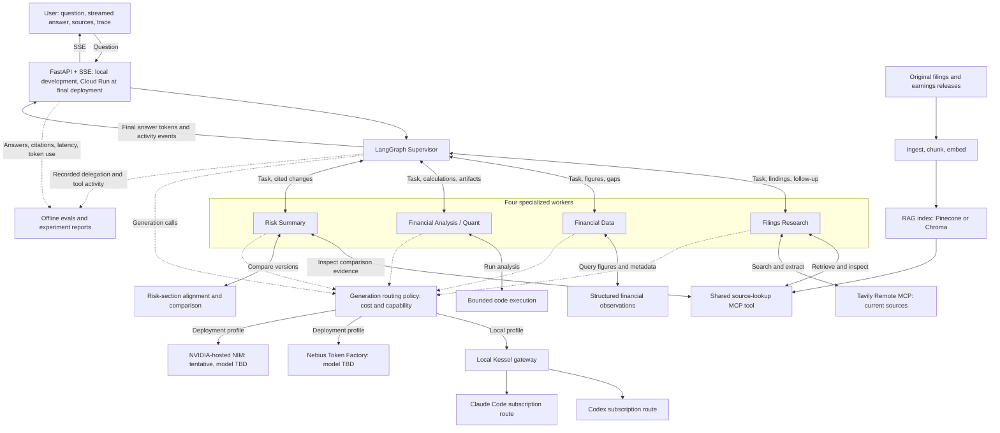

# Public-Company Research Assistant — Project Spec

- Owner: Rylan Wade.
- Status: chosen project; planning only. No implementation or evaluation results are claimed.
- Product name: TBD.
- Assignment contract: [Assignment 2](../assignment/Assignment_2_Description.md).
- Origin: [company research idea](../ideas/public-company-research-assistant.md). This spec governs the selected scope where it differs from that exploration.

## Purpose

- Help a user answer: **what changed in this company, do the numbers support the explanation, and what remains uncertain?**
- Combine original company reports, structured financial figures, reproducible calculations, and current reporting into an answer the user can inspect.
- Serve people learning or doing company research: finance students, junior analysts, and self-directed investors.
- Keep the explanation accessible. Define financial terms when needed and show the evidence behind conclusions.

## Initial scope

- Start with the semiconductor sector and 3–5 supported companies. Choose the exact list after checking document and financial-data coverage. Approximately 20 companies remains an expansion target, conditional on evidence that the smaller version works.
- Begin with roughly two years of annual and quarterly reports, plus relevant earnings releases. Collect enough original material to support substantive retrieval across topics and periods. Transcripts and a third year can follow when they add useful coverage.
- Initially target companies using domestic SEC reporting forms. Supporting foreign issuers and their reporting formats is a later coverage decision.
- Support company explanations, financial comparisons, changes in disclosed risks, and current developments related to those questions.
- Begin with revenue growth, gross margin, operating margin, and operating cash flow. Treat segment-level figures and additional metrics as later additions because their definitions and source coverage need separate checks.
- Produce a research brief: a direct conclusion, supporting evidence, a financial table or chart when useful, changed risks when relevant, and unresolved questions.
- Defer market quotes, price-move explanations, valuation tools, trading, forecasts, watchlists, and background alerts. They are outside the initial scope.
- Treat each initial request as self-contained. Conversation memory and persistence remain later decisions; do not promise memory across sessions or instance replacement.

## Development environment and provider direction

- Develop and test locally using Rylan Wade's Codex and Claude Code subscriptions for coding, independent testing, and review. Provide local browser demonstrations and run the deployment container locally before cloud deployment.
- Test individual application agents directly in Codex sessions, with their role instructions, permitted tools, and evaluation questions. These tests must run independently of Kessel.
- Use [Kessel](../../../../kessel/README.md), Rylan Wade's existing localhost gateway, for full-application local generation and compatible automated evaluation-judge calls. Its OpenAI-compatible Codex and Claude Code routes let the application call the authenticated subscription-backed CLIs through a normal model-client interface. Kessel integration in HW2 is planned, not yet tested.
- Deploy to Cloud Run at the end, after local acceptance. Repeat the relevant end-to-end and evaluation checks against the live service, including cloud-specific cold starts, resource use, concurrency, and streaming.
- Nebius Token Factory is selected as one application generation provider. Its API is OpenAI-compatible; using a compatible client does not make OpenAI the hosting provider. Exact models remain unselected. [Nebius API reference](https://api.tokenfactory.nebius.com/docs).
- NVIDIA-hosted NIM is the tentative second provider. NVIDIA advertises free developer access for prototyping; verify the selected endpoint's access, limits, and suitability for the coursework deployment before confirming it. Do not assume a specific credit allowance or unrestricted production service. [NVIDIA developer access](https://developer.nvidia.com/nim).
- Nebius and NVIDIA-hosted endpoints are two different serving providers. Routing decisions must record the serving provider separately from the model publisher and client library, and exercise both under normal supported workloads.
- Decide model assignments and routing thresholds from measured task performance, latency, and cost. Do not assume which provider is cheaper or more capable before comparing the chosen models.
- Use subscription-backed Codex and Claude Code agents for local development testing. Do not call Nebius/NVIDIA generation APIs or separate paid judge APIs during development. In the final integration/deployment milestone, configure the selected runtime providers, verify their integration locally, then deploy and retest on Cloud Run. Do not treat subscription-assisted tests as measurements of the selected runtime providers.

## Kessel local integration

- Local request path: **browser → HW2 FastAPI/LangGraph → Kessel on localhost → Codex or Claude Code CLI**. Use the same application agents, role prompts, tools, state, and evaluation datasets that will be used with deployed providers.
- Kessel's documented OpenAI-compatible base URLs are `http://127.0.0.1:4880/v1/codex` and `http://127.0.0.1:4880/v1/claude`, with a private local Kessel key. These are SDK base URLs, not full chat-completion paths. Kessel keeps CLI authentication under the installed provider CLIs; its local key authenticates access to the gateway.
- Prefer app-managed Kessel startup through its existing `kessel run` workflow. Do not copy Kessel source or credential stores into HW2, expose the gateway remotely, or include it in the Cloud Run application image. Record the tested Kessel version and optional local setup instructions when integration begins.
- Keep local Kessel configuration separate from the Nebius/NVIDIA deployment configuration. Select the endpoint profile explicitly; switching profiles should preserve orchestration and tools while changing model clients and model IDs. Never send a Kessel key to an external provider.
- HW2 owns tool execution. Kessel returns tool-call names/arguments; the application validates and invokes the actual retrieval, data, comparison, or analysis tools and supplies the results in the next model request. Kessel's CLI processes need no direct access to the HW2 tools.
- Use Kessel for model-backed end-to-end local runs and, where compatible, RAGAS/AgentEvals judge calls. Keep independently checked reference values and calibrate model judgments with human review.
- Verify the exact LangChain/RAGAS client behavior early: ordinary generation, streamed text, tool-call round trips, structured outputs, model selection, errors, and concurrency. Kessel implements a defined API subset; its current schema excludes JSON Schema references and strict function-tool schemas. Configure compatible schemas and do not assume unsupported sampling controls are effective.
- Kessel's documented API routes do not include embeddings. Prefer a local embedding model for subscription-based development; choose and verify its quality during the retrieval work. This is separate from generation-provider routing.
- Keep local Kessel latency/token observations separate from deployment-provider measurements. Kessel/CLI overhead and subscription usage do not establish Nebius/NVIDIA latency, billing, or answer quality.
- Run local container checks with an explicitly tested connection to the host gateway; container localhost does not refer to the host Kessel process. The connection method is a local integration detail to resolve before container testing.

## Local testing paths

| Test scope | Execution path | Evidence to retain |
| --- | --- | --- |
| Individual specialist or supervisor role | Fresh direct Codex session with the role prompt and permitted local tools/MCP access; bypass Kessel. | Question, prompt/tool configuration, actual calls and returned data, answer, source/calculation checks, and failures. |
| Deterministic components and graph transitions | Ordinary local tests with fixtures or scripted model responses. | Assertions for extraction, financial values, state transitions, errors, and streaming contracts. |
| Full model-backed application and automated model judges | Local FastAPI/LangGraph and compatible evaluators through Kessel. | Application traces, worker handoffs, citations, artifacts, evaluator outputs, and gateway errors. |
| Final provider and deployed acceptance | Selected Nebius/second-provider endpoints, first locally and then on Cloud Run. | Actual provider quality, routing, latency, cost, and cloud-specific behavior. |

- Reuse the source-checked questions and reference evidence across direct Codex tests and application tests. Give each direct session only the intended role's tool access; keep implementation and evaluation sessions distinct.
- Direct Codex testing is the default for single-agent development and debugging. Kessel availability must not block those tests or become a dependency of their runner.
- Direct role tests assess that role's prompts, tools, and evidence use. Full application tests separately verify the production graph, model adapters, and frontend integration.
- If Kessel fails, retain the gateway failure as integration evidence and continue independent direct Codex tests. Do not silently substitute a direct session for a passed full-application run or switch to paid APIs.

## User experience

- Ask an ordinary question about a supported company or comparison, with a period if relevant.
- Receive visible progress and an inspectable record of which agents, tools, and providers handled the request.
- Read a streamed answer with citations. Progress messages alone do not satisfy answer-token streaming.
- Open the exact passage or financial observation behind a claim. Inspect the source inputs and formula behind a calculation.
- Change the company, period, or assumption and request a revised analysis. Retain the self-contained request boundary until conversation context is deliberately implemented.
- Receive a clear coverage limitation or missing-data explanation when the system cannot support a conclusion.

## Five agents

| Agent | Job | Distinct tools and output |
| --- | --- | --- |
| Filings Research | Read company disclosures and investigate relevant current developments. | RAG retrieval and source inspection; Tavily Remote MCP search/extraction. Returns cited findings, management explanations, and evidence gaps. |
| Financial Data | Obtain the right financial figures and establish whether they are comparable. | Structured financial-data and filing-metadata queries. Returns observations with company, dates, units, metric definition, and filing identity. |
| Financial Analysis / Quant | Use the figures to answer numerical questions. | Generate and run bounded analysis code over supplied data; validate calculations and create tables/charts. Returns results with source inputs, formulas, and assumptions. Maps to the assignment's Code role. |
| Risk Summary | Identify what changed between versions of risk disclosures. | Align and compare risk sections; inspect before/after passages. Returns a cited brief distinguishing added, removed, changed, and relocated language. |
| Supervisor | Coordinate the investigation and assemble the final response. | LangGraph delegation and task-state inspection. Selects workers, requests bounded follow-up, handles incomplete results, and synthesizes the evidence. |

- Four specialized workers exceed the three-worker minimum. The supervisor does not count toward that minimum.
- Keep five agents. Evaluation runs outside the application workflow; it does not introduce a sixth verification agent.
- Each worker needs a distinct prompt and meaningful tool access. Risk Summary must perform document comparison rather than repeat Filings Research.
- Workers return findings through the supervisor. Shared state carries the question, selected companies/periods, task status, evidence references, calculations, gaps, routing decisions, and failures; the detailed schema comes later.

## High-level diagram

- Solid arrows show request, delegation, and tool/data paths. Dotted arrows show generation routing and evaluation capture. Tool arrows represent access, not a requirement to invoke every tool on every request.
- Financial Data passes observations to Financial Analysis through supervisor-managed state. Document collection and structured-data preparation happen separately from normal chat requests.
- Routing is a service used by the five agents. Evals are development infrastructure. Neither is an extra specialist.
- Both deployed generation providers must be exercised under normal supported workloads, with visible reasons. Provider choice depends on task difficulty and cost/capability needs rather than permanently assigning each worker one provider. Local experiments identify the actual Codex/Claude Code route; they must not be labeled as Nebius/NVIDIA runs.
- The diagram shows the application execution path. Direct single-agent Codex tests are a separate development path that bypasses Kessel.

## How an investigation works

- Example question: "Revenue increased. Did profitability and cash flow improve too?"
- The supervisor asks Filings Research for management's explanation and Financial Data for the matching figures.
- Financial Analysis calculates growth and margins after checking periods, units, and metric definitions. It identifies unsupported comparisons instead of silently combining incompatible data.
- If relevant, Risk Summary compares the corresponding disclosures. Filings Research checks current sources when the question requires developments beyond the indexed reports.
- A contradiction or missing input triggers a bounded follow-up. The supervisor then generates a cited conclusion that distinguishes what the evidence establishes from what remains uncertain.
- A simple lookup can use one worker; a complex comparison can use several. The graph must choose according to task state and handle worker failure without collapsing the request.

## Evidence and reliability

- Preserve original company identity, filing/document identity, reporting period, filing date, source location, and version. Keep amendments or restatements distinguishable.
- Use RAG over original source chunks, with ingestion, embeddings, vector retrieval, prompt augmentation, and citations back to those chunks. Structured financial queries complement this pipeline.
- Use the SEC data/source path as the starting point for document discovery and financial observations; verify coverage and definitions during implementation. Use Tavily Remote MCP for the assignment's live-knowledge requirement.
- Make the shared source-lookup MCP tool accessible to Filings Research and Risk Summary. Demonstrate both invoking the same tool for different tasks to satisfy MCP sharing.
- Keep management statements, outside reporting, and the assistant's interpretation distinguishable. A citation must support the specific claim.
- Show fiscal dates and distinguish quarter-only, year-to-date, annual, and point-in-time observations. Report comparison limits explicitly.
- Record publication/retrieval dates for current evidence. Failed or stale retrieval must not produce a confident claim about current conditions.
- Validate citations, calculation inputs, and output structure within the existing agents and ordinary code. Bound follow-up and code execution; define the execution restrictions before implementing Quant.

## Exploration first, formal evaluation later

- Start by building small working capabilities and trying ordinary questions in direct Codex sessions and the local application. Inspect sources, figures, tool calls, and failures, and collect Rylan Wade's feedback to discover what the system can usefully do.
- Keep basic correctness and integration tests alongside implementation. Early milestones do not require a benchmark dataset, model judge, RAGAS scores, evaluation framework setup, or predefined quality thresholds. Retain useful traces and failures so later evaluation design is based on observed behavior.
- Begin formal evaluation after the initial research and financial-analysis workflows have been demonstrated and their intended behavior is clearer. Choose the evaluation checkpoint with Rylan Wade based on that feedback; do not force it into the first milestone.
- At that checkpoint, define supported task families, source-checked reference cases, held-out questions, a reproducible evaluation command, and suitable metrics. Integrate RAGAS through compatible Kessel-backed generation/judges and add trajectory evaluation for the working graph. Verify client compatibility before counting scores; keep any unsupported metric pending rather than silently using paid APIs.
- Use a contemporary evaluation approach: assess the final answer, retrieved evidence, agent actions, and operational behavior separately. Tool selection alone does not establish correctness, and a grounded answer can still rely on the wrong period or stale source.
- Use **RAGAS** for the required faithfulness, answer relevance, context precision, and context recall report. Its current metric catalog also includes agent/tool-use metrics. Select exact metrics and pin compatible versions during implementation. [RAGAS metric documentation](https://docs.ragas.io/en/latest/concepts/metrics/available_metrics/).
- Use **AgentEvals** for evaluating agent trajectories: the recorded tool calls and graph steps. It supports matching tool calls/arguments and model-based judgments of trajectories. Prefer flexible checks where several valid execution paths exist. [AgentEvals documentation](https://github.com/langchain-ai/agentevals).
- Keep datasets, traces, evaluation execution, and experiment reports local during development. **LangSmith** remains the preferred optional comparison surface if hosted reporting is later requested, subject to account access and a verified budget. It supports dataset experiments, code/model evaluators, pairwise comparisons, and online evaluation. Hosted reporting is not a development prerequisite. [LangSmith evaluation documentation](https://docs.langchain.com/langsmith/evaluation-types).
- These tools provide experience with current evaluation workflows; this spec does not claim a single framework is universally state of the art. The key learning goals are dataset design, trace analysis, judge calibration, and controlled experiments.

| Evaluation area | What to measure |
| --- | --- |
| Retrieval and answer quality | Required RAGAS metrics; retrieval of the correct company/period; reference-answer correctness; claim-level citation support and citation coverage. |
| Financial correctness | Independently calculated expected values, units, fiscal dates, formulas, and table/chart consistency. Use deterministic checks with explicit rounding tolerances. |
| Risk changes | Human-reviewed before/after passages and change labels; measure classification errors, including relocated boilerplate incorrectly called a new risk. |
| Agent behavior | Required evidence obtained, correct tool arguments, sensible delegation, evidence handoff, unnecessary calls, bounded follow-up, and actual shared-MCP use. Accept alternative valid paths. |
| Missing or conflicting evidence | Honest partial answers or abstention, retained disagreements, failed-worker recovery, and resistance to instructions embedded in retrieved documents. |
| Operational behavior | Retrieval/LLM/total latency, answer-token TTFT, cold/warm behavior, token-derived cost, and provider comparisons. Track evaluation costs separately. |

- When formal evaluation begins, start with independently checked examples informed by exploratory use. Expand with real failures and user feedback. Keep development examples separate from a held-out set used to assess generalization.
- Record source snapshots, expected evidence, reference calculations, allowed tool behaviors, dataset versions, prompts, provider/model IDs, and code revision. Separate repeatable snapshot tests from dated live-retrieval probes.
- Combine fast offline checks with real-model runs and real MCP integration checks. Fixtures are useful for replay; they do not prove that deployed tools or current sources work.
- Use direct Codex subscription-backed sessions for individual-agent tests and independent inspection of local tools, sources, calculations, and outputs. Codex supports local MCP servers, subagent workflows, and scripted `codex exec` runs that reuse saved CLI authentication. A subscription-backed session can exercise actual tool calls and return a structured test report without Kessel. [Codex MCP](https://learn.chatgpt.com/docs/extend/mcp?surface=cli), [subagents](https://learn.chatgpt.com/docs/agent-configuration/subagents), and [non-interactive execution](https://learn.chatgpt.com/docs/non-interactive-mode).
- Give direct testing agents the relevant role instructions and tool access. During exploration, try ordinary questions and inspect actual calls, returned evidence, calculations, and failure behavior. Add fixed question sets and source-based scoring rubrics at the formal evaluation checkpoint. Use fixture/scripted model responses to check graph transitions, SSE handling, and failure paths locally as those components are built.
- Use the existing Kessel gateway for API-based full-application runs and compatible automated judges before building another gateway adapter. Prove model-backed graph execution, structured outputs, trace capture, and evaluator compatibility through its existing API. Keep direct Codex single-agent tests independent of that integration.
- Label Kessel-backed end-to-end runs, independent testing-agent reports, scripted graph tests, and target-provider integration tests separately. Re-run the required evaluations with the actual deployment configuration during final integration; measure Nebius/NVIDIA quality, latency, routing, and cost then.
- Calibrate model judges against human-reviewed good and bad answers, including deliberately wrong periods, unsupported citations, and incorrect calculations. Inspect judge disagreements and retain their explanations. Do not let an unreviewed model-generated reference answer define truth.
- Once the formal evaluation harness exists, compare substantial changes with the preceding version and a simple baseline on the same dataset. Use blinded pairwise review for explanation quality; run a small repeated sample to expose variability. Report sample sizes and uncertainty rather than treating a tiny score change as conclusive.
- Define formal quality thresholds after the intended behavior is understood and a baseline is measured. Continue rejecting fabricated source identifiers and invalid financial comparisons during ordinary correctness checks; choosing benchmark scores is a later decision.
- Store factual reports in [docs/evaluation.md](../evaluation.md) when measurements exist. Keep intermediate experiments under `docs/research/`; do not prefill submission results.

## Incremental development and feedback

- Rylan Wade will implement the project with coding agents, one bounded milestone at a time. Milestones are deliberately unfilled below; this document authorizes planning, not implementation.
- Each future milestone should define a user-visible outcome, a runnable demonstration, relevant correctness checks, exit criteria, and a feedback checkpoint before work starts. Formal evaluation cases become part of milestone acceptance after the evaluation checkpoint is selected.
- All development milestones run locally. Include local Docker startup, SSE, and resource checks; reserve cloud deployment and deployed retesting for the final milestone. The earlier discussion of an early Cloud Run deployment is superseded by this local-first workflow.
- Complete the scoped increment, inspect its actual evidence/tool behavior, run its checks, and provide the exact way Rylan Wade can try it. Report working behavior and remaining limitations separately.
- Review the demonstration, observed failures, and Rylan Wade's feedback before defining or starting the next increment. Include scored evaluation failures once formal evaluations exist. Change scope based on observed value; do not build the entire proposed system before obtaining feedback.
- Distinguish coding agents used to build/test the repository from the five application agents. Independent testing can provide useful feedback without adding another runtime agent.
- Apply lessons from the [HW1 process log](../../../HW1/PROCESS_LOG.md): test ordinary real questions, inspect tools and returned evidence, turn observed failures into repeatable cases, and catch feature expansion early.
- The HW1 [matching evaluation](../../../HW1/docs/research/MATCHING_VALUE_EVALUATION.md) shows why added complexity needs a measured benefit. The [deployment report](../../../HW1/docs/research/PERFORMANCE_VERIFICATION.md) shows why startup, memory, cold starts, and concurrent requests need actual deployment checks. Use these as lessons; HW2 keeps its own implementation and evidence.

## Decisions to make later

| Decision | Resolve before |
| --- | --- |
| Exact companies, filing families, date range, and coverage expansion | Initial collection; refine coverage using working demos and feedback before fixing the evaluation dataset. |
| Metric/tag definitions, fiscal alignment, amendments/restatements, and missing-data behavior | Structured-data and financial-analysis implementation. |
| Chunking, embeddings, retrieval filters/k, and Pinecone versus Chroma | First RAG implementation and retrieval experiment. |
| NVIDIA confirmation, exact Nebius/NVIDIA model IDs, routing thresholds, and budgets | First live generation integration; verify current access, model capabilities, and pricing. |
| Kessel/LangChain compatibility, local endpoint profiles, and host access from Docker | First model-backed application tests and container checks. |
| Formal evaluation checkpoint, supported task families, and RAGAS/AgentEvals compatibility | After working research and financial-analysis demos clarify what should be measured. |
| Quant execution boundaries and permitted analysis libraries | Code execution. |
| Judge model, evaluation dataset size/splits, calibration rubric, and final integration budgets | First model-judged evaluations; use subscriptions during development and verify the final reporting path before submission. |
| Optional LangSmith hosted comparison/reporting | Any requested hosted evaluation/reporting integration. |
| Report/chart presentation and source-inspection interaction | First frontend demonstration. |
| Conversation context and whether memory must survive instance replacement | Any multi-turn promise; external durable state is required if that survival is claimed. |
| Refresh policy for documents, financial observations, and current sources | Freshness claims in user-visible answers. |
| Cloud Run resource/concurrency limits and acceptable latency | Deployment acceptance, based on measurements. |
| Product name and optional coverage/features | Feedback showing the initial workflow is useful. |

## Assignment completion boundary

- Finish with working LangGraph orchestration, four distinct specialists, substantive RAG, Tavily Remote MCP, inspectable routing across at least two generation providers, shared MCP use, and FastAPI-served vanilla HTML/JS with answer-token SSE, sources, and traces.
- Demonstrate a public Cloud Run deployment handling unfamiliar reasonable questions within declared coverage, cold starts, and partial failures. Meet external-persistence requirements if durable memory is later promised.
- Deliver the required architecture report, measured evaluation report, setup/deploy README, exactly pinned dependencies, placeholder configuration, source archive, and Rylan Wade's own process log.
- This planning diagram does not replace the final architecture documentation. Update that document to reflect implemented and verified behavior.

## Final completion checklist

- [ ] Complete local acceptance and verify the selected deployment-provider integrations.
- [ ] Deploy to Cloud Run and verify public access, cold starts, streaming, routing, citations, and failure handling.
- [ ] Re-run the relevant evaluations against the deployed application and record actual results.
- [ ] Finalize architecture/evaluation documentation, setup/deployment instructions, dependency pins, placeholder configuration, and source-archive preparation.
- [ ] **Final step — Rylan Wade:** after deployment and deployed retesting, complete [PROCESS_LOG.md](../../PROCESS_LOG.md) with a personal reflection of **200–300 words total** across AI tools used, development narrative, verification narrative, and what you learned. Include the completed log in the submission archive. Agents must request his actual reflection and must not invent it; submission readiness remains pending until this item is complete.

## Milestones
