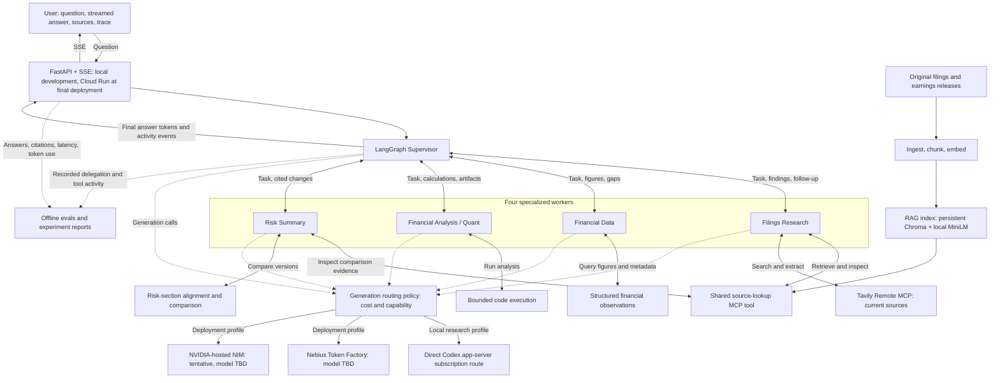

# Public-Company Research Assistant — Project Spec

- Owner: Rylan Wade.
- Status: M1–M5 implemented and verified; M2 and M3 accepted. M6 is authorized for implementation and verification. M7–M12, remaining workers, deployment-provider integration, formal evaluations, and deployment are unstarted.
- Product name: TBD.
- Assignment contract: [Assignment 2](../assignment/Assignment_2_Description.md).
- Scope/source evidence: [M1 feasibility](M1_SCOPE_AND_SOURCE_FEASIBILITY.md).
- Product description: [Public-Company Research Assistant](../ideas/public-company-research-assistant.md). This spec governs the selected design and development constraints.

## Purpose

- Help a user answer: **what changed in this company, do the numbers support the explanation, and what remains uncertain?**
- Combine original company reports, structured financial figures, reproducible calculations, and current reporting into an answer the user can inspect.
- Serve people learning or doing company research: finance students, junior analysts, and self-directed investors.
- Keep the explanation accessible. Define financial terms when needed and show the evidence behind conclusions.

## Initial scope

- Initial company set: **NVIDIA (NVDA), AMD (AMD), Intel (INTC), and Qualcomm (QCOM)**. All four use domestic SEC 10-K/10-Q reporting forms.
- Coverage starts with these four companies and is planned to expand toward approximately 20, subject to verified source coverage, working demonstrations, and feedback. Foreign issuers require a separate reporting-format decision.
- Initial corpus: **41 verified documents** — eight 10-Ks, twenty-four Q1–Q3 10-Qs, eight Q4/full-year earnings releases, and AMD's FY2025 10-K/A. A filing's SEC original and official mirror count as one document. [M2 preparation](M2_SOURCE_COLLECTION_AND_PREPARATION.md) records originals, readable extraction, section/table checks, and provenance. RAG ingestion uses local MiniLM embeddings and persistent Chroma.
- Selected coverage is two completed fiscal years per company, with actual dates shown below. NVIDIA's year labels differ from the other companies. These are explicit historical windows, not a claim of latest-report coverage.

| Company | Selected fiscal years | Fiscal start → end |
| --- | --- | --- |
| NVIDIA | FY2025; FY2026 | 2024-01-29 → 2025-01-26; 2025-01-27 → 2026-01-25 |
| AMD | FY2024; FY2025 | 2023-12-31 → 2024-12-28; 2024-12-29 → 2025-12-27 |
| Intel | FY2024; FY2025 | 2023-12-31 → 2024-12-28; 2024-12-29 → 2025-12-27 |
| Qualcomm | FY2024; FY2025 | 2023-09-25 → 2024-09-29; 2024-09-30 → 2025-09-28 |

- SEC metadata and matching-duration USD inputs are verified for all 32 original reports. All 41 selected bodies and extractions are verified, with no collection gaps. All 32 original risk and MD&A sections are available; AMD's amendment supplies corrected MD&A without replacing original risks.
- Source access constraints: direct local SEC Archives probes returned 403; use verified official IR mirrors/CDNs and validate actual content. Qualcomm gross profit requires revenue minus cost of revenue; its FY2024 has 53 weeks versus 52 in FY2025. Preserve AMD's amendment and corrected MD&A alongside its original annual report.
- Prefer within-company financial comparisons. Cross-company comparisons must display fiscal dates and timing/business-mix qualifications. Initial metrics use consolidated US GAAP figures; segment metrics, transcripts, additional years, and additional companies require separate coverage checks and feedback.
- Support company explanations, financial comparisons, changes in disclosed risks, and current developments related to those questions.
- Initial metrics: consolidated US GAAP revenue growth, gross margin, operating margin, and operating cash flow in USD. The [M1 financial evidence](M1_SCOPE_AND_SOURCE_FEASIBILITY.md#5-financial-feasibility-and-comparison-boundaries) records candidate tags, formulas, annual observations, and period constraints. Observation selection uses exact original accessions and actual intervals, with later conflicting comparatives retained separately. [M5](M5_FINANCIAL_DATA_AGENT.md) implements the Data worker; numerical derivations remain M6 work.
- Produce a research brief: a direct conclusion, supporting evidence, a financial table or chart when useful, changed risks when relevant, and unresolved questions.
- Defer market quotes, price-move explanations, valuation tools, trading, forecasts, watchlists, and background alerts. They are outside the initial scope.
- Treat each initial request as self-contained. Conversation memory and persistence remain later decisions; do not promise memory across sessions or instance replacement.

## Development environment and provider direction

- Use uv for dependency management and execution. Python 3.13 is selected in `.python-version` and `pyproject.toml`; exact direct pins and `uv.lock` govern the environment. Export exact `requirements.txt` pins for the assignment with the documented uv command. Use `uv sync --locked` and `uv run --locked` for reproducible local commands.
- Develop and test locally using Rylan Wade's Codex and Claude Code subscriptions for coding, independent testing, and review. Provide local browser demonstrations and run the deployment container locally before cloud deployment.
- Test individual application agents directly in Codex sessions, with their role instructions, permitted tools, and evaluation questions. These runs must be independently reproducible without the supervisor or browser.
- Use Codex app-server directly for local generation, dynamic research-tool calls, and streamed answers. The installed CLI retains authentication; HW2 does not read or copy credentials. CLI version/model and actual demonstration results belong in the M3 evidence.
- Deploy to Cloud Run at the end, after local acceptance. Repeat the relevant end-to-end and evaluation checks against the live service, including cloud-specific cold starts, resource use, concurrency, and streaming.
- Nebius Token Factory is selected as one application generation provider. Its API is OpenAI-compatible; using a compatible client does not make OpenAI the hosting provider. Exact models remain unselected. [Nebius API reference](https://api.tokenfactory.nebius.com/docs).
- NVIDIA-hosted NIM is the tentative second provider. NVIDIA advertises free developer access for prototyping; verify the selected endpoint's access, limits, and suitability for the coursework deployment before confirming it. Do not assume a specific credit allowance or unrestricted production service. [NVIDIA developer access](https://developer.nvidia.com/nim).
- Nebius and NVIDIA-hosted endpoints are two different serving providers. Routing decisions must record the serving provider separately from the model publisher and client library, and exercise both under normal supported workloads.
- Decide model assignments and routing thresholds from measured task performance, latency, and cost. Do not assume which provider is cheaper or more capable before comparing the chosen models.
- Use subscription-backed Codex and Claude Code agents for local development testing. Do not call Nebius/NVIDIA generation APIs or separate paid judge APIs during development. In the final integration/deployment milestone, configure the selected runtime providers, verify their integration locally, then deploy and retest on Cloud Run. Do not treat subscription-assisted tests as measurements of the selected runtime providers.

## Direct Codex local integration

- Local request path: **browser → HW2 FastAPI/LangGraph → Codex app-server → authenticated Codex subscription**.
- HW2 starts an ephemeral, read-only Codex thread per supported request and supplies the Filings Research role prompt and dynamic tools. The application validates arguments, executes retrieval/inspection, and returns evidence to Codex.
- Codex's JSON-RPC app-server protocol provides text deltas and tool-call round trips. The application streams final-answer deltas; commentary does not enter the answer. [Official app-server protocol](https://learn.chatgpt.com/docs/app-server).
- Local generation defaults to `gpt-6.1-sol`; `RESEARCH_MODEL` selects another accessible Codex model. Tool calls are bounded to eight and the model phase to 180 seconds. Requests use fresh threads and no conversation-memory promise.
- Local embedding generation uses CPU ONNX MiniLM; it requires no generation API key. Chroma persists the versioned index under ignored `chroma_index/`.
- Full application runs and direct worker runs share the actual role prompt/tools. Direct runs bypass LangGraph and the browser, so their evidence remains separate from application/browser acceptance.
- Subscription latency does not establish Nebius/NVIDIA price, latency, or quality. Deployment-provider clients and formal judge compatibility remain separate acceptance work.
- Container acceptance must verify the local Codex connection, executable availability, authentication isolation, and cancellation explicitly. Keep credentials outside source archives and deployment images.

## Local testing paths

| Test scope | Execution path | Evidence to retain |
| --- | --- | --- |
| Individual specialist or supervisor role | Fresh direct Codex worker run with its role prompt and permitted local tools. | Question, prompt/tool configuration, actual calls and returned data, answer, source/calculation checks, and failures. |
| Deterministic components and graph transitions | Ordinary local tests with fixtures or scripted model responses. | Assertions for extraction, financial values, state transitions, errors, and streaming contracts. |
| Full model-backed application | Local FastAPI/LangGraph through direct Codex app-server. | Application traces, worker handoffs, citations, artifacts, streaming, and model errors. |
| Formal model judges | Subscription-backed adapters with verified evaluator compatibility. | Actual evaluator outputs, calibration, and integration failures; currently pending. |
| Final provider and deployed acceptance | Selected Nebius/second-provider endpoints, first locally and then on Cloud Run. | Actual provider quality, routing, latency, cost, and cloud-specific behavior. |

- Reuse the source-checked questions and reference evidence across direct Codex tests and application tests. Give each direct session only the intended role's tool access; keep implementation and evaluation sessions distinct.
- Direct Codex testing is the default for single-agent development and debugging. `scripts/research.py agent` invokes Filings Research independently of the application graph.
- Direct role tests assess that role's prompts, tools, and evidence use. Full application tests separately verify the production graph, model adapters, and frontend integration.
- Model failures produce explicit unsuccessful terminal events. Do not count an independent role run as a passed browser/application run or switch silently to paid APIs.

## User experience

- Ask an ordinary question about a supported company or comparison, with a period if relevant.
- Receive visible progress and an inspectable record of which agents, tools, and providers handled the request.
- Read a streamed answer with citations. Progress messages alone do not satisfy answer-token streaming.
- Open the exact passage or financial observation behind a claim. Inspect the source inputs and formula behind a calculation.
- Change the company, period, or assumption and request a revised analysis. Retain the self-contained request boundary until conversation context is deliberately implemented.
- Receive a clear coverage limitation or missing-data explanation when the system cannot support a conclusion.

## Five agents

| Agent | Job | Distinct tools and output |
| --- | --- | --- |
| Filings Research | Read company disclosures and investigate relevant current developments. | RAG retrieval and source inspection; Tavily Remote MCP search/extraction. Returns cited findings, management explanations, and evidence gaps. |
| Financial Data | Obtain the right financial figures and establish whether they are comparable. | Structured financial-data and filing-metadata queries. Returns observations with company, dates, units, metric definition, and filing identity. |
| Financial Analysis / Quant | Use the figures to answer numerical questions. | Generate and run bounded analysis code over supplied data; validate calculations and create tables/charts. Returns results with source inputs, formulas, and assumptions. Maps to the assignment's Code role. |
| Risk Summary | Identify what changed between versions of risk disclosures. | Align and compare risk sections; inspect before/after passages. Returns a cited brief distinguishing added, removed, changed, and relocated language. |
| Supervisor | Coordinate the investigation and assemble the final response. | LangGraph delegation and task-state inspection. Selects workers, requests bounded follow-up, handles incomplete results, and synthesizes the evidence. |

- Four specialized workers exceed the three-worker minimum. The supervisor does not count toward that minimum.
- Filings Research, Financial Data, and a minimal scope/task supervisor are implemented; Quant and Risk Summary remain planned. The four-worker design describes the final assignment scope.
- Keep five agents. Evaluation runs outside the application workflow; it does not introduce a sixth verification agent.
- Each worker needs a distinct prompt and meaningful tool access. Risk Summary must perform document comparison rather than repeat Filings Research.
- Workers return findings through the supervisor. Shared state carries the question, selected companies/periods, task status, evidence references, calculations, gaps, routing decisions, and failures; the detailed schema comes later.

## Selected full-system design

- Solid arrows show request, delegation, and tool/data paths. Dotted arrows show generation routing and evaluation capture. Tool arrows represent access, not a requirement to invoke every tool on every request.
- Financial Data passes observations to Financial Analysis through supervisor-managed state. Document collection and structured-data preparation happen separately from normal chat requests.
- Routing is a service used by the five agents. Evals are development infrastructure. Neither is an extra specialist.
- Both deployed generation providers must be exercised under normal supported workloads, with visible reasons. Provider choice depends on task difficulty and cost/capability needs rather than permanently assigning each worker one provider. Local experiments identify the actual Codex/Claude Code route; they must not be labeled as Nebius/NVIDIA runs.
- The diagram describes the selected full-system design; the current M3 execution path is in [architecture](../architecture.md). Direct single-worker Codex runs bypass the supervisor and browser.

## Planned investigation workflow

- Example question: "Revenue increased. Did profitability and cash flow improve too?"
- The supervisor asks Filings Research for management's explanation and Financial Data for the matching figures.
- Financial Analysis calculates growth and margins after checking periods, units, and metric definitions. It identifies unsupported comparisons instead of silently combining incompatible data.
- If relevant, Risk Summary compares the corresponding disclosures. Filings Research checks current sources when the question requires developments beyond the indexed reports.
- A contradiction or missing input triggers a bounded follow-up. The supervisor then generates a cited conclusion that distinguishes what the evidence establishes from what remains uncertain.
- A simple lookup can use one worker; a complex comparison can use several. The graph must choose according to task state and handle worker failure without collapsing the request.

## Evidence and reliability

- Preserve original company identity, filing/document identity, reporting period, filing date, source location, and version. Keep amendments or restatements distinguishable.
- Use RAG over original source chunks, with ingestion, embeddings, vector retrieval, prompt augmentation, and citations back to those chunks. Structured financial queries complement this pipeline.
- Use the SEC data/source path as the starting point for document discovery and financial observations; verify coverage and definitions during implementation. Use Tavily Remote MCP for the assignment's live-knowledge requirement.
- Make the shared source-lookup MCP tool accessible to Filings Research and Risk Summary. Demonstrate both invoking the same tool for different tasks to satisfy MCP sharing.
- Keep management statements, outside reporting, and the assistant's interpretation distinguishable. A citation must support the specific claim.
- Show fiscal dates and distinguish quarter-only, year-to-date, annual, and point-in-time observations. Report comparison limits explicitly.
- Record publication/retrieval dates for current evidence. Failed or stale retrieval must not produce a confident claim about current conditions.
- Validate citations, calculation inputs, and output structure within the existing agents and ordinary code. Bound follow-up and code execution; define the execution restrictions before implementing Quant.

## Exploration first, formal evaluation later

- Start by building small working capabilities and trying ordinary questions in direct Codex sessions and the local application. Inspect sources, figures, tool calls, and failures, and collect Rylan Wade's feedback to discover what the system can usefully do.
- Keep basic correctness and integration tests alongside implementation. Early milestones do not require a benchmark dataset, model judge, RAGAS scores, evaluation framework setup, or predefined quality thresholds. Retain useful traces and failures so later evaluation design is based on observed behavior.
- Begin formal evaluation after the initial research and financial-analysis workflows have been demonstrated and their intended behavior is clearer. Choose the evaluation checkpoint with Rylan Wade based on that feedback; do not force it into the first milestone.
- At that checkpoint, define supported task families, source-checked reference cases, held-out questions, a reproducible evaluation command, and suitable metrics. Integrate RAGAS through verified subscription-backed generation/judge adapters and add trajectory evaluation for the working graph. Verify client compatibility before counting scores; keep any unsupported metric pending rather than silently using paid APIs.
- Use a contemporary evaluation approach: assess the final answer, retrieved evidence, agent actions, and operational behavior separately. Tool selection alone does not establish correctness, and a grounded answer can still rely on the wrong period or stale source.
- Use **RAGAS** for the required faithfulness, answer relevance, context precision, and context recall report. Its current metric catalog also includes agent/tool-use metrics. Select exact metrics and pin compatible versions during implementation. [RAGAS metric documentation](https://docs.ragas.io/en/latest/concepts/metrics/available_metrics/).
- Use **AgentEvals** for evaluating agent trajectories: the recorded tool calls and graph steps. It supports matching tool calls/arguments and model-based judgments of trajectories. Prefer flexible checks where several valid execution paths exist. [AgentEvals documentation](https://github.com/langchain-ai/agentevals).
- Keep datasets, traces, evaluation execution, and experiment reports local during development. **LangSmith** remains the preferred optional comparison surface if hosted reporting is later requested, subject to account access and a verified budget. It supports dataset experiments, code/model evaluators, pairwise comparisons, and online evaluation. Hosted reporting is not a development prerequisite. [LangSmith evaluation documentation](https://docs.langchain.com/langsmith/evaluation-types).
- These tools provide experience with current evaluation workflows; this spec does not claim a single framework is universally state of the art. The key learning goals are dataset design, trace analysis, judge calibration, and controlled experiments.

| Evaluation area | What to measure |
| --- | --- |
| Retrieval and answer quality | Required RAGAS metrics; retrieval of the correct company/period; reference-answer correctness; claim-level citation support and citation coverage. |
| Financial correctness | Independently calculated expected values, units, fiscal dates, formulas, and table/chart consistency. Use deterministic checks with explicit rounding tolerances. |
| Risk changes | Human-reviewed before/after passages and change labels; measure classification errors, including relocated boilerplate incorrectly called a new risk. |
| Agent behavior | Required evidence obtained, correct tool arguments, sensible delegation, evidence handoff, unnecessary calls, bounded follow-up, and actual shared-MCP use. Accept alternative valid paths. |
| Missing or conflicting evidence | Honest partial answers or abstention, retained disagreements, failed-worker recovery, and resistance to instructions embedded in retrieved documents. |
| Operational behavior | Retrieval/LLM/total latency, answer-token TTFT, cold/warm behavior, token-derived cost, and provider comparisons. Track evaluation costs separately. |

- When formal evaluation begins, start with independently checked examples informed by exploratory use. Expand with real failures and user feedback. Keep development examples separate from a held-out set used to assess generalization.
- Record source snapshots, expected evidence, reference calculations, allowed tool behaviors, dataset versions, prompts, provider/model IDs, and code revision. Separate repeatable snapshot tests from dated live-retrieval probes.
- Combine fast offline checks with real-model runs and real MCP integration checks. Fixtures are useful for replay; they do not prove that deployed tools or current sources work.
- Use direct Codex subscription-backed sessions for individual-agent tests and independent inspection of local tools, sources, calculations, and outputs. Codex supports local MCP servers, subagent workflows, and scripted `codex exec` runs that reuse saved CLI authentication. A subscription-backed session can exercise actual tool calls and return a structured test report independently of the application graph. [Codex MCP](https://learn.chatgpt.com/docs/extend/mcp?surface=cli), [subagents](https://learn.chatgpt.com/docs/agent-configuration/subagents), and [non-interactive execution](https://learn.chatgpt.com/docs/non-interactive-mode).
- Give direct testing agents the relevant role instructions and tool access. During exploration, try ordinary questions and inspect actual calls, returned evidence, calculations, and failure behavior. Add fixed question sets and source-based scoring rubrics at the formal evaluation checkpoint. Use fixture/scripted model responses to check graph transitions, SSE handling, and failure paths locally as those components are built.
- Use direct Codex app-server for full-application generation and prove model-backed graph execution, tool round trips, answer streaming, and trace capture. Verify formal evaluator-client compatibility at the evaluation checkpoint; keep direct worker runs separately reproducible.
- Label direct Codex application runs, independent worker runs, scripted graph tests, and target-provider integration tests separately. Re-run the required evaluations with the actual deployment configuration during final integration; measure Nebius/NVIDIA quality, latency, routing, and cost then.
- Calibrate model judges against human-reviewed good and bad answers, including deliberately wrong periods, unsupported citations, and incorrect calculations. Inspect judge disagreements and retain their explanations. Do not let an unreviewed model-generated reference answer define truth.
- Once the formal evaluation harness exists, compare substantial changes with the preceding version and a simple baseline on the same dataset. Use blinded pairwise review for explanation quality; run a small repeated sample to expose variability. Report sample sizes and uncertainty rather than treating a tiny score change as conclusive.
- Define formal quality thresholds after the intended behavior is understood and a baseline is measured. Continue rejecting fabricated source identifiers and invalid financial comparisons during ordinary correctness checks; choosing benchmark scores is a later decision.
- Store factual reports in [docs/evaluation.md](../evaluation.md) when measurements exist. Keep intermediate experiments under `docs/research/`; do not prefill submission results.

## Incremental development and feedback

- Development proceeds through the authorized sequence. M1–M5 are implemented and verified; M2 and M3 are accepted. M6 is authorized for implementation and verification; M7–M12 remain planned and unstarted.
- Each future milestone should define a user-visible outcome, a runnable demonstration, relevant correctness checks, exit criteria, and a feedback checkpoint before work starts. Formal evaluation cases become part of milestone acceptance after the evaluation checkpoint is selected.
- Development and application acceptance run locally, including Docker startup, SSE, and resource checks. Cloud deployment and deployed retesting belong to the final milestone.
- Complete the scoped increment, inspect its actual evidence/tool behavior, run its checks, and provide the exact way Rylan Wade can try it. Report working behavior and remaining limitations separately.
- Review the demonstration, observed failures, and Rylan Wade's feedback before defining or starting the next increment. Include scored evaluation failures once formal evaluations exist. Change scope based on observed value; do not build the entire proposed system before obtaining feedback.
- Distinguish coding agents used to build/test the repository from the five application agents. Independent testing can provide useful feedback without adding another runtime agent.
- Test ordinary real questions, inspect tool calls and evidence, turn observed failures into repeatable cases, and bound feature expansion. Additional complexity requires evidence of benefit.
- Verify startup, memory, cold starts, and concurrent requests with actual application/deployment checks. Keep HW2 implementation, configuration, artifacts, and reflections independent of other assignments.

## Decisions to make later

| Decision | Resolve before |
| --- | --- |
| Coverage expansion and additional reporting formats | Source collection is verified for all 41 selected documents. Future discovery/refresh CLI is implemented; expand application coverage only after source checks, demonstrations, and feedback. |
| Observation selection and fiscal intervals | M5 implements original-accession GAAP USD observations, explicit quarter/YTD intervals, missing/conflicting statuses, and retained later revisions. Quant derivation checks remain M6. |
| Retrieval refinement and corpus expansion | M3 uses 220-token chunks, 40-token overlap, CPU MiniLM, cosine Chroma, and explicit company/fiscal-year/form/section/version filters. Refine from observed evidence and feedback. |
| NVIDIA confirmation, exact Nebius/NVIDIA model IDs, routing thresholds, and budgets | Final runtime-provider integration; verify current access, capabilities, and pricing before local provider acceptance and deployment. |
| Local Codex connectivity and authentication isolation | Verified host bridge, absent container CLI credentials, and child cancellation; [M4 evidence](M4_LOCAL_CONTAINER_ACCEPTANCE.md). |
| Formal evaluation checkpoint, supported task families, and RAGAS/AgentEvals compatibility | After working research and financial-analysis demos clarify what should be measured. |
| Quant execution boundaries and permitted analysis libraries | Code execution. |
| Judge model, evaluation dataset size/splits, calibration rubric, and final integration budgets | First model-judged evaluations; use subscriptions during development and verify the final reporting path before submission. |
| Optional LangSmith hosted comparison/reporting | Any requested hosted evaluation/reporting integration. |
| Report/chart presentation and source-view refinements | M3 provides exact passages, citations, official source links, and collected originals. Refine through feedback. |
| Conversation context and whether memory must survive instance replacement | Any multi-turn promise; external durable state is required if that survival is claimed. |
| Refresh policy for financial observations and current sources | Documents support explicit CLI refresh and future inventories; no scheduler or automatic freshness promise. Decide observation/live-source policies before freshness claims. |
| Cloud Run resource/concurrency limits and acceptable latency | Deployment acceptance, based on measurements. |
| Product name and optional coverage/features | Feedback showing the initial workflow is useful. |

## Assignment completion boundary

- Finish with working LangGraph orchestration, four distinct specialists, substantive RAG, Tavily Remote MCP, inspectable routing across at least two generation providers, shared MCP use, and FastAPI-served vanilla HTML/JS with answer-token SSE, sources, and traces.
- Demonstrate a public Cloud Run deployment handling unfamiliar reasonable questions within declared coverage, cold starts, and partial failures. Meet external-persistence requirements if durable memory is later promised.
- Deliver the required architecture report, measured evaluation report, setup/deploy README, exactly pinned dependencies, placeholder configuration, source archive, and Rylan Wade's own process log.
- This planning diagram does not replace the final architecture documentation. Update that document to reflect implemented and verified behavior.

## Final completion checklist

- [ ] Complete local acceptance and verify the selected deployment-provider integrations.
- [ ] Deploy to Cloud Run and verify public access, cold starts, streaming, routing, citations, and failure handling.
- [ ] Re-run the relevant evaluations against the deployed application and record actual results.
- [ ] Finalize architecture/evaluation documentation, setup/deployment instructions, dependency pins, placeholder configuration, and source-archive preparation.
- [ ] **Final step — Rylan Wade:** after deployment and deployed retesting, complete [PROCESS_LOG.md](../../PROCESS_LOG.md) with a personal reflection of **200–300 words total** across AI tools used, development narrative, verification narrative, and what you learned. Include the completed log in the submission archive. Agents must request his actual reflection and must not invent it; submission readiness remains pending until this item is complete.

## Milestones

| Milestone | Status | Outcome |
| --- | --- | --- |
| M1 — Scope and source feasibility | Complete | Four companies, two fiscal years each, 41-document target, 32/32 reports with aligned financial inputs, source-access evidence, and unresolved gaps in [M1 feasibility](M1_SCOPE_AND_SOURCE_FEASIBILITY.md). |
| M2 — Source collection and preparation | Implemented and verified; accepted | 41/41 bodies and extractions, versioned provenance, 32 risk/MD&A sections, AMD amendment, table checks, reusable uv CLI, and no collection gaps. [Evidence](M2_SOURCE_COLLECTION_AND_PREPARATION.md). |
| M3 — First RAG research demo | Implemented and verified; accepted | 41 documents/10,681 chunks, four real cited application turns, direct worker/browser demonstrations, coverage gaps, and cancellation/failure checks. [Evidence](M3_FIRST_RAG_RESEARCH_DEMO.md). |
| M4 — Local container acceptance | Implemented and verified locally | Docker startup, cited SSE, Chromium, custom PORT, non-root identity, credential isolation, cancellation, and model failure pass. [Evidence](M4_LOCAL_CONTAINER_ACCEPTANCE.md). |
| M5 — Financial Data agent | Implemented and verified locally | Source-linked GAAP observations, original-report policy, structured Data worker, direct/browser/Docker checks. [Evidence](M5_FINANCIAL_DATA_AGENT.md). |
| M6 — Financial Analysis / Quant agent | Planned; unstarted | Bounded code execution, checked calculations, and tables/charts. |
| M7 — Risk Summary agent | Planned; unstarted | Cited comparisons of disclosure versions and relevant quarterly updates. |
| M8 — Full supervisor cooperation | Planned; unstarted | All four workers cooperate through task-driven delegation, follow-up, and failure recovery. |
| M9 — Live research and MCP sharing | Planned; unstarted | Tavily current research and inspectable use of the same MCP tool by different workers. |
| M10 — Inspectable provider routing | Planned; unstarted | Routing policy exercised through local subscription routes; deployment profiles prepared. |
| M11 — Research experience and formal evaluation | Planned; unstarted | Usable reports/traces, meaningful evaluation datasets and results, and local release acceptance. |
| M12 — Provider acceptance, deployment, and submission | Planned; unstarted | Actual deployment providers verified, Cloud Run retested, deliverables completed, then Rylan Wade's process log. |

- This skeleton defines the sequence and boundaries; it does not authorize implementation of future milestones. Before each increment, resolve its necessary open decisions and confirm its concrete acceptance demonstration within the authorized scope.
- Each handoff records changed files, commands to reproduce the demonstration/checks, verified results, gaps, and the next feedback decision. Update milestone status from actual evidence and obtain Rylan Wade's feedback before proceeding.
- Individual-agent testing uses direct Codex. Full model-backed application runs use direct Codex app-server; basic code/contract checks use local fixtures where appropriate. No Cloud Run deployment or Nebius/NVIDIA generation calls before M12.
- Formal evaluation starts at a feedback-approved checkpoint after the research and numerical workflows are useful. It may begin after M6; M11 is the required local evaluation and consolidation gate. Early milestones need demonstrations and correctness checks, not benchmark scores.

### M2 — Source collection and preparation

- **Inputs/dependency:** completed M1, especially its access evidence, earnings releases, amendment notes, and filing inventory (§§3–5, 9).
- **Scope:** collect the 41-document target using verified original/official mirror paths; resolve remaining NVIDIA/Qualcomm downloads. Save original bodies, readable extracted text, canonical identities, retrieval URLs/dates, versions, and collection status. Validate HTML/PDF content and section/table fidelity; a successful HTTP response is insufficient. Deduplicate mirrors without merging amendments into originals.
- **Demonstration/exit:** inspect one source and its extraction for each company, AMD's original/amended MD&A, and annual/quarterly risk sections. Account for all 41 targets with verified bodies or explicit failures; unresolved material gaps require a coverage decision before acceptance. Provide repeatable collection commands with bounded retries and source-identifying requests.
- **Boundary:** no vector index, application workers, frontend, or formal evaluation harness. Preserve the four-company historical coverage unless feedback authorizes a change.
- **Implemented:** `data/source_inventory.json`, collection/discovery CLI, ignored content-addressed originals and prepared files, explicit refresh/run history, and offline inspection/verification. `uv` is the project standard. [M2 report](M2_SOURCE_COLLECTION_AND_PREPARATION.md) records current decisions, demonstration, evidence, and limits; M2 is accepted.

### M3 — First RAG research demo

- **Inputs/dependency:** accepted M2 collection and extraction/provenance records.
- **Scope:** choose and pin local embeddings, vector store, chunking, and retrieval filters; implement ingest → retrieve → augment → generate. Build source lookup/inspection tools, the Filings Research worker, a minimal LangGraph supervisor, and a simple FastAPI-served vanilla browser chat with answer-token SSE. Verify direct Codex app-server/tool-call compatibility; expose research tools for direct Codex testing.
- **Demonstration/exit:** ordinary questions retrieve the correct company/period and return supporting citations that open the original passage. Inspect tool calls and show missing-source/unsupported-coverage behavior, plus a full local model-backed application turn. Record retrieval and prompt settings in the architecture document.
- **Boundary:** this is the first usable slice, not the full four-worker supervisor. Choose source-view interactions through feedback; defer visual polish, live research, and formal scoring.
- **Implemented/verified:** CPU MiniLM and cosine Chroma with scoped retrieval, exact passage inspection, LCEL augmentation, Filings Research, a minimal LangGraph supervisor, and direct Codex answer-token SSE. Four-company application turns, the independent AMD worker, Chromium citations/traces, missing coverage, unavailable model, and disconnect cleanup pass. [M3 evidence](M3_FIRST_RAG_RESEARCH_DEMO.md) records actual outputs/settings/limits; M3 is accepted.

### M4 — Local container acceptance

- **Inputs/dependency:** working M3 application.
- **Scope:** containerize the research slice using the assignment's build/runtime requirements. Verify startup, PORT handling, assets/index access, local Codex connectivity, SSE, and resource use. Verify the actual executable/connection and credential isolation; CLI credentials remain outside the application image.
- **Demonstration/exit:** start the local container from documented commands and complete a cited streaming question. Inspect a fresh container start, client disconnect, and model-unavailable behavior; record observations without labeling them Cloud Run measurements.
- **Boundary:** local Docker only. Cloud resources, deployment credentials, and cloud acceptance remain M12 work.
- **Implemented/verified:** digest-pinned multi-stage image, authenticated host bridge with one owned Codex child per connection, isolated mounts, and local application/browser acceptance. [M4 evidence](M4_LOCAL_CONTAINER_ACCEPTANCE.md).

### M5 — Financial Data agent

- **Inputs/dependency:** accepted local research slice; M1 §5 financial mappings and reporting-period constraints.
- **Scope:** implement structured SEC financial observations and the Data worker's queries. Retain exact accessions, units, dates, source links, and selected revision basis; handle repeated intervals, missing inputs, GAAP/non-GAAP distinctions, and quarter-only versus cumulative values. Preserve Qualcomm's derived gross-profit inputs and 53-week qualification.
- **Demonstration/exit:** direct Codex tests retrieve the expected observations from each company, then a local application request displays sourced figures. Check selected values against their filings and show incompatible or missing data explicitly.
- **Boundary:** establish reliable inputs; generated analysis code and general chart production belong to M6.
- **Implemented/verified:** four hashed SEC snapshots, 280 observation slots/250 available, 32 annual reference checks, four direct workers, financial browser/API inspection, missing/period/concurrency checks, and expanded Docker acceptance. [M5 evidence](M5_FINANCIAL_DATA_AGENT.md).

### M6 — Financial Analysis / Quant agent

- **Inputs/dependency:** working M5 observations and their provenance.
- **Scope:** define execution limits and permitted libraries, then implement the Quant worker's bounded code generation/execution, growth/margin calculations, and table/chart artifacts. Validate periods, denominators, units, revisions, and calculation lineage; derive quarterly cash flow only from compatible cumulative inputs.
- **Demonstration/exit:** answer a revenue/margin/cash-flow question through the existing app and independently check the calculations. Show invalid comparisons, zero denominators, missing inputs, and execution failure handling. Direct Codex tests exercise the role's actual analysis tools.
- **Feedback decision:** review whether the research/numerical workflow is useful and select when formal evaluation should begin. Do not require a benchmark framework to complete this milestone.

### M7 — Risk Summary agent

- **Inputs/dependency:** versioned M2 sources and source inspection from M3.
- **Scope:** implement risk-section alignment/comparison tools and the Risk Summary worker. Compare annual versions and retain quarterly update/parent relationships; distinguish new, removed, changed, and relocated text with before/after evidence.
- **Demonstration/exit:** direct Codex and application demonstrations explain a real disclosure change with both passages. Show moved boilerplate, incomplete quarterly risk inventories, and amendments that are not replacement risk sections. Source availability alone is not a successful comparison.
- **Boundary:** keep significance judgments qualified and source-backed; do not claim that a disclosed risk caused a stock-price move.

### M8 — Full supervisor cooperation

- **Inputs/dependency:** all four workers from M3, M5, M6, and M7.
- **Scope:** expand the minimal supervisor into task-driven delegation using documented shared state and structured worker results. Add dependency-aware handoffs, bounded follow-up, failure/partial-result handling, and final synthesis. Keep each worker's prompts and tools distinct.
- **Demonstration/exit:** contrast a simple request invoking only needed workers with a question requiring cooperation. Show additional evidence changing or qualifying an interpretation, and a failed worker producing a useful partial result. Inspect the actual assignments, inputs, results, and follow-up in the trace.
- **Boundary:** LangGraph coordinates the workers; keep the five-agent design. Add scored trajectory evaluation only once the formal evaluation checkpoint is active.

### M9 — Live research and MCP sharing

- **Inputs/dependency:** working supervisor, research tools, and Risk Summary worker.
- **Scope:** integrate authenticated Tavily Remote MCP via the assignment's Streamable HTTP connection. Add dated current-source research and live-search failure handling. Expose shared source lookup through MCP and exercise the same tool from Research and Risk Summary in distinct contexts.
- **Demonstration/exit:** answer a current question beyond the historical corpus, retaining publication/retrieval dates and citations. Inspect real MCP discovery/calls, both workers' shared-tool invocations, and stale/unavailable-source behavior.
- **Boundary:** current retrieval supplements the historical corpus; it does not silently update coverage or establish a refresh service. Record transport/account gaps separately from successful public webpage access.

### M10 — Inspectable provider routing

- **Inputs/dependency:** working local multi-agent application and explicit endpoint profiles.
- **Scope:** implement task-sensitive generation routing with visible provider/model selection and reasons. Exercise distinct subscription-backed generation routes through verified local adapters; prepare separate Nebius/second-provider configuration and trace fields. Document provisional routing dimensions and fallback behavior.
- **Demonstration/exit:** simple and demanding supported tasks exercise both local routes with honest labels. Verify routing inputs, selection reasons, failures, and configuration isolation. Do not report local subscription measurements as Nebius/NVIDIA price, latency, or quality evidence.
- **Boundary:** confirm deployment models, the second provider, and actual performance-based policy adjustments in M12. No deployment-provider generation calls here.

### M11 — Research experience and formal evaluation

- **Inputs/dependency:** useful local workflows, feedback, and any evaluation work started at the agreed checkpoint after M6.
- **Scope:** refine briefs, tables/charts, source inspection, routing visibility, and readable traces. Use observed successes/failures to define reference cases, held-out questions, judge calibration, and a reproducible local evaluation harness. Complete required RAGAS metrics, numerical/citation checks, and suitable AgentEvals trajectory checks through verified local integrations.
- **Demonstration/exit:** unfamiliar questions work through the browser; evaluation reports contain actual outputs, sample sizes, failures, and recorded configurations. Compare against a simple baseline, inspect judge disagreements, and run local failure/concurrency/container checks. Resolve material local integration/evaluation gaps before deployment acceptance.
- **Boundary:** formal evaluation reflects capabilities demonstrated in earlier increments. Hosted reporting is optional; production-provider comparisons and cloud measurements remain M12.

### M12 — Provider acceptance, deployment, and submission

- **Inputs/dependency:** accepted M11 local release and evaluation evidence.
- **Scope:** verify current Nebius/second-provider access, model capabilities, pricing, and budgets; wire and exercise both real providers locally. Re-run supported questions/evaluations, measure routing quality/latency/cost, and adjust the policy from those results. Deploy to Cloud Run, then retest public access, SSE/citations/traces, arbitrary reasonable queries, cold/warm behavior, concurrency, and partial failures.
- **Demonstration/exit:** provide the working URL and actual deployment evidence; finish factual architecture/evaluation reports, setup/deploy/provider documentation, dependency pins, placeholder configuration, and the secret-free submission archive. Verify external persistence only if durable memory was added and promised.
- **Final step — Rylan Wade:** after deployment and deployed retesting, supply the personal 200–300-word `PROCESS_LOG.md` across its four required sections, then include it in the archive. Follow the final completion checklist; agents do not invent his reflection or mark submission complete while it is missing.
